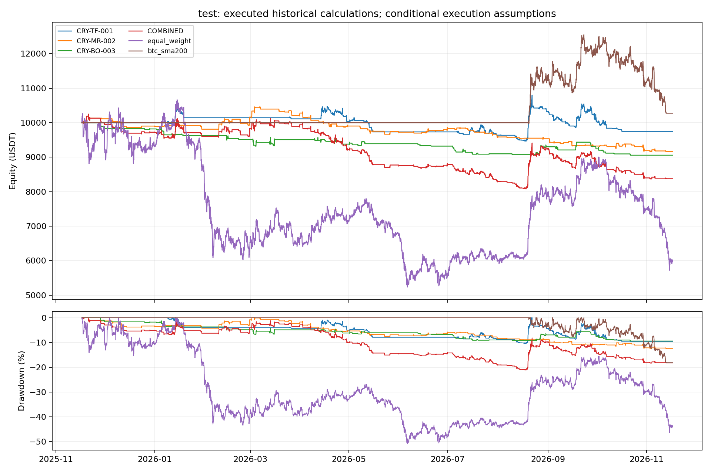

# Stage 02: executed historical backtest and independent validation

**Status: conditional historical research. These are calculations executed on downloaded historical candles, not live returns or verified executable fills. No strategy receives an unconditional Pass.**

## A. Reproducible methodology

Methodology `1.1.0`, executed source commit `07927ffd690bf13bf4b838fe50139444d4218f4b`. The source-file SHA-256 hashes, Python/dependency versions and UTC execution timestamps are in [run metadata](results/run_metadata.json). Rules are in [STAGE_01_HANDOFF.json](STAGE_01_HANDOFF.json); the [preregistration](PREREGISTRATION.md) was committed before performance evaluation.

Venue: Binance.com spot. Symbols: BTCUSDT, ETHUSDT, SOLUSDT. Quote unit: USDT. Time zone: UTC. Signals: 1H and 4H; execution resolution: 1 minute. Evaluation interval [2021-11-17 00:00, 2026-11-17 00:00) UTC. Additional data from 2021-05-01 provide warm-up. All three strategies were run independently and under one shared-capital allocator. Each split starts flat with 10,000 USDT; the splits are separate account experiments, not a single compounded five-year account.

| Window | Start inclusive UTC | End exclusive UTC |
| --- | --- | --- |
| Train | 2021-11-17 | 2024-11-17 |
| Validation | 2024-11-17 | 2025-11-17 |
| Final test | 2025-11-17 | 2026-11-17 |

No parameter optimization was performed. Signals use completed candles; higher-timeframe features are shifted to their availability timestamps. Entries and bar-close exits execute at the next strategy-bar open. Stops and targets use minute candles, with stop-first treatment when chronology inside a minute is unknowable. Trailing changes apply only after a strategy candle closes. Window-end exits are forced and labelled `boundary`. Indicator warm-up resets after missing hourly data, requiring another 1,000 consecutive 4H bars.

**Holdout integrity:** preliminary test calculations executed during implementation review. Correctness fixes addressed exact-boundary cooldown, causal minute-gap handling and partial-fill capacity accounting. Runs were repeated without performance-driven parameter selection. The final test has the preregistered dates but is consumed and is not a pristine single-pass untouched holdout. Do not reuse it as untouched evidence for subsequent versions. Source history records the corrections; an intermediate checkpoint is not an authoritative archive of the initial partial run.

**Risk and capital:** initial risk at most 1% per trade and reserved total risk at most 3% at entry; at most three positions, one per asset, no leverage, 33% notional cap per asset. Original risk remains reserved until full exit. Quantities round down to explicitly assumed lot steps and must meet assumed 10 USDT minimum notional. Stops round down and targets up to assumed 0.01 USDT ticks. Stop gaps may exceed planned risk.

**Costs:** baseline 10bp fee + 2bp assumed half-spread + 3bp assumed slippage on each side. High-cost scenario: 20bp fee + 10bp combined adverse adjustment; high-slippage scenario: 10bp fee + 20bp adjustment. No funding or borrow costs apply to unlevered owned spot inventory. USDT=USD is an unverified baseline valuation assumption. Effective target prices include the handoff's adverse cost haircut; these are conservative modeled effective prices, not reconstructed native resting-limit fills.

**Partial fills:** baseline retains Stage 01 full fills under the hourly participation cap. A separate stress caps fills at 1% of the preceding completed minute quote volume, cancels unfilled entry quantity, and carries unfinished market exits forward. This deterministic proxy does not reproduce order-book queues or historical fill probabilities. Window-end liquidation is uncapped in that stress and explicitly counted.

**Metric definitions:** CAGR uses actual elapsed years of 365.25 days. Volatility and Sharpe use UTC daily returns with annualization 365.25 and zero risk-free rate. Sortino uses all-day downside deviation about zero. Drawdown uses hourly marked equity including initial capital, so minute-level drawdowns can be deeper. Recovery measures the worst drawdown's peak to recovery and is censored at window end when unrecovered. Trade R is net P&L divided by initial reserved risk; expectancy is the unweighted mean of those R values. Exposure is average hourly-end gross inventory/equity; very short intrahour exposure can be undercounted. Turnover is annualized two-way executed notional divided by mean equity.

Reproduce from a clean checkout:

```bash
python -m pip install -r requirements.txt
python download.py
python verify_data.py
python -m unittest -v test_lab
python -W ignore::FutureWarning run.py --sensitivity
python make_report.py
python validate_results.py
```

## B. Final-test baseline metrics

| strategy | CAGR | annual_volatility | Sharpe | Sortino | max_drawdown |
| --- | --- | --- | --- | --- | --- |
| CRY-TF-001 | -2.53% | 12.12% | -0.152 | -0.308 | -10.47% |
| CRY-MR-002 | -8.34% | 6.41% | -1.326 | -1.886 | -12.47% |
| CRY-BO-003 | -9.43% | 5.18% | -1.886 | -2.677 | -9.42% |
| COMBINED | -16.24% | 14.21% | -1.177 | -2.156 | -21.17% |
| equal_weight | -40.25% | 53.25% | -0.701 | -0.986 | -50.90% |
| btc_sma200 | 2.76% | 19.46% | 0.236 | 0.381 | -18.14% |

Trend-following has a positive unweighted mean R but negative account P&L and profit factor below one: trade risk amounts differ because of notional, liquidity and capital caps. Its aggregate net P&L/aggregate initial risk is negative. A positive unweighted trade average is therefore not evidence of positive portfolio returns.

| strategy | trade_count | win_rate | profit_factor | expectancy_R | mean_gross_exposure | annual_two_way_turnover | ending_equity |
| --- | --- | --- | --- | --- | --- | --- | --- |
| CRY-TF-001 | 81 | 19.75% | 0.900 | 0.078 | 9.46% | 42.783 | 9,747.34 |
| CRY-MR-002 | 172 | 41.28% | 0.742 | -0.183 | 4.19% | 106.757 | 9,166.87 |
| CRY-BO-003 | 107 | 23.36% | 0.579 | -0.252 | 2.60% | 66.078 | 9,057.74 |

All final-test accounts have 365 daily observations. A zero/undefined denominator is reported as unavailable rather than inventing a finite ratio. Full metrics for every split, account and scenario are in [metrics.csv](results/metrics.csv). Benchmark trade statistics are deliberately unavailable because their equity accounting is not a stop-risk trade ledger.

### Chronological split comparison

| strategy | window | CAGR | Sharpe | max_drawdown | trade_count | expectancy_R |
| --- | --- | --- | --- | --- | --- | --- |
| CRY-TF-001 | train | 3.43% | 0.404 | -16.75% | 197.0 | 0.064 |
| CRY-TF-001 | validation | -0.52% | 0.015 | -8.85% | 114.0 | 0.007 |
| CRY-TF-001 | test | -2.53% | -0.152 | -10.47% | 81.0 | 0.078 |
| CRY-MR-002 | train | -15.26% | -2.216 | -39.56% | 352.0 | -0.263 |
| CRY-MR-002 | validation | -12.37% | -1.370 | -17.73% | 205.0 | -0.101 |
| CRY-MR-002 | test | -8.34% | -1.326 | -12.47% | 172.0 | -0.183 |
| CRY-BO-003 | train | -5.61% | -0.920 | -19.24% | 247.0 | -0.082 |
| CRY-BO-003 | validation | 1.38% | 0.214 | -7.22% | 105.0 | -0.037 |
| CRY-BO-003 | test | -9.43% | -1.886 | -9.42% | 107.0 | -0.252 |

### Cost and fill sensitivity: final test

| strategy | scenario | CAGR | trade_count | expectancy_R |
| --- | --- | --- | --- | --- |
| CRY-TF-001 | baseline | -2.53% | 81.0 | 0.078 |
| CRY-MR-002 | baseline | -8.34% | 172.0 | -0.183 |
| CRY-BO-003 | baseline | -9.43% | 107.0 | -0.252 |
| CRY-TF-001 | high_cost | -7.93% | 81.0 | -0.022 |
| CRY-MR-002 | high_cost | -19.51% | 160.0 | -0.303 |
| CRY-BO-003 | high_cost | -17.28% | 107.0 | -0.377 |
| CRY-TF-001 | high_slippage | -7.99% | 81.0 | -0.018 |
| CRY-MR-002 | high_slippage | -15.68% | 132.0 | -0.312 |
| CRY-BO-003 | high_slippage | -17.90% | 107.0 | -0.410 |
| CRY-TF-001 | partial_fill | -5.53% | 81.0 | 0.077 |
| CRY-MR-002 | partial_fill | -6.87% | 172.0 | -0.182 |
| CRY-BO-003 | partial_fill | -10.23% | 107.0 | -0.253 |

### Uncertainty

| strategy | test trades | adjusted lower bound | descriptive 95% interval |
| --- | --- | --- | --- |
| CRY-TF-001 | 81 | -0.354 | [-0.334, 0.364] |
| CRY-MR-002 | 172 | -0.280 | [-0.269, 0.067] |
| CRY-BO-003 | 107 | -0.433 | [-0.415, 0.013] |

Intervals estimate aggregate net P&L / aggregate initial risk, which differs from unweighted mean trade R. Circular 14-day daily-P&L/risk blocks, 10,000 replications, seed 20261117; one-sided 98.33% bounds address the three strategy hypotheses. These intervals cover sampling variation conditional on this surviving cohort and execution model, not model uncertainty or selection bias. The 100-trade minimum is a decision threshold, not proof that 100 trades are independent.

## C. Equity, drawdown, year and regime analysis

| strategy | max_drawdown | recovery_days | recovery_censored | drawdown_peak | drawdown_trough |
| --- | --- | --- | --- | --- | --- |
| CRY-TF-001 | -10.47% | 219.0 | False | 2026-01-14 21:00:00+00:00 | 2026-08-18 11:00:00+00:00 |
| CRY-MR-002 | -12.47% | 255.0 | True | 2026-03-06 23:00:00+00:00 | 2026-11-03 04:00:00+00:00 |
| CRY-BO-003 | -9.42% | 365.0 | True | 2025-11-17 00:00:00+00:00 | 2026-10-22 00:00:00+00:00 |
| COMBINED | -21.17% | 361.0 | True | 2025-11-20 23:00:00+00:00 | 2026-08-18 11:00:00+00:00 |
| equal_weight | -50.90% | 306.1 | True | 2026-01-14 21:00:00+00:00 | 2026-06-06 05:00:00+00:00 |
| btc_sma200 | -18.14% | 54.8 | True | 2026-09-23 05:00:00+00:00 | 2026-11-13 01:00:00+00:00 |

`recovery_censored=True` means recovery had not occurred by test end; the reported duration is only the elapsed lower bound.



[Training chart](results/train_equity_drawdown.png) · [Validation chart](results/validation_equity_drawdown.png)

### Calendar-year performance, separated at split boundaries
| strategy | window | year | days | return | closed_trades |
| --- | --- | --- | --- | --- | --- |
| CRY-TF-001 | train | 2021 | 45 | 0.00% | 0 |
| CRY-TF-001 | train | 2022 | 365 | -3.81% | 33 |
| CRY-TF-001 | train | 2023 | 365 | 9.38% | 74 |
| CRY-TF-001 | train | 2024 | 321 | 5.18% | 90 |
| CRY-TF-001 | validation | 2024 | 45 | -0.32% | 22 |
| CRY-TF-001 | validation | 2025 | 320 | -0.20% | 92 |
| CRY-TF-001 | test | 2025 | 45 | 0.00% | 0 |
| CRY-TF-001 | test | 2026 | 320 | -2.53% | 81 |
| CRY-MR-002 | train | 2021 | 45 | 0.00% | 0 |
| CRY-MR-002 | train | 2022 | 365 | -17.13% | 141 |
| CRY-MR-002 | train | 2023 | 365 | -6.18% | 62 |
| CRY-MR-002 | train | 2024 | 321 | -21.74% | 149 |
| CRY-MR-002 | validation | 2024 | 45 | -1.64% | 30 |
| CRY-MR-002 | validation | 2025 | 320 | -10.89% | 175 |
| CRY-MR-002 | test | 2025 | 45 | -1.04% | 16 |
| CRY-MR-002 | test | 2026 | 320 | -7.37% | 156 |
| CRY-BO-003 | train | 2021 | 45 | 0.00% | 0 |
| CRY-BO-003 | train | 2022 | 365 | -6.84% | 67 |
| CRY-BO-003 | train | 2023 | 365 | 2.05% | 72 |
| CRY-BO-003 | train | 2024 | 321 | -11.54% | 108 |
| CRY-BO-003 | validation | 2024 | 45 | 0.44% | 11 |
| CRY-BO-003 | validation | 2025 | 320 | 0.93% | 94 |
| CRY-BO-003 | test | 2025 | 45 | -1.80% | 6 |
| CRY-BO-003 | test | 2026 | 320 | -7.76% | 101 |

### Final-test market-regime attribution
| strategy | regime | days | mean_daily_return | entry_trades | expectancy_R |
| --- | --- | --- | --- | --- | --- |
| CRY-TF-001 | bear_highvol | 31 | 0.00% | 0 | — |
| CRY-TF-001 | bear_lowvol | 249 | 0.01% | 47 | 0.285 |
| CRY-TF-001 | bull_lowvol | 85 | -0.04% | 34 | -0.208 |
| CRY-MR-002 | bear_highvol | 31 | 0.19% | 23 | 0.244 |
| CRY-MR-002 | bear_lowvol | 249 | -0.04% | 99 | -0.264 |
| CRY-MR-002 | bull_lowvol | 85 | -0.05% | 50 | -0.221 |
| CRY-BO-003 | bear_highvol | 31 | -0.07% | 8 | -0.404 |
| CRY-BO-003 | bear_lowvol | 249 | -0.03% | 67 | -0.276 |
| CRY-BO-003 | bull_lowvol | 85 | -0.00% | 32 | -0.163 |

Regimes use only prior completed BTC daily observations: close above/below SMA200, crossed with prior 30-day annualized volatility above/below 60%. Daily returns are attributed by that day's known regime; trades by entry regime. Regime-only compounded returns are not a tradable separate account, and regime means do not imply causal explanation. Small cells are weak evidence.

### Training-only parameter stability
| strategy | runs | minimum_CAGR | maximum_CAGR | minimum_expectancy_R | maximum_expectancy_R |
| --- | --- | --- | --- | --- | --- |
| CRY-BO-003 | 16 | -6.94% | -2.54% | -0.107 | -0.035 |
| CRY-MR-002 | 8 | -17.28% | -9.30% | -0.298 | -0.202 |
| CRY-TF-001 | 14 | 0.35% | 6.63% | 0.015 | 0.123 |

One-at-a-time ±20% lookback and ATR-multiplier perturbations were executed only on training data. No replacement parameters were selected. Individual runs are in [training_parameter_sensitivity.csv](results/training_parameter_sensitivity.csv).

## D. Benchmarks

The first table includes equal-weight BTC/ETH/SOL buy-and-hold and a simple BTC daily SMA200 long/cash rule. Both pay the same modeled fees and adverse execution costs; both assume full fills. Accounts restart at each split. Benchmark concentration and exposure differ from the strategies, so their raw returns are not risk-matched comparisons.

## E. Bias and data-quality audit

| symbol | 1H missing | 1m missing | duplicates | invalid | flagged hourly observations, incl warmup | quote-volume mismatches, incl warmup |
| --- | --- | --- | --- | --- | --- | --- |
| BTCUSDT | 1 | 80 | 0 | 0 | 0 | 12 |
| ETHUSDT | 1 | 80 | 0 | 0 | 2 | 14 |
| SOLUSDT | 1 | 81 | 0 | 0 | 6 | 28 |

492 primary files passed official SHA-256 checksums. Raw coverage for all assets starts 2021-05-01 00:00 UTC and ends 2026-11-16 23:59 UTC at minute resolution. The evaluation has 43,824 expected hourly candles per asset, with one missing. All assets miss the 2023-03-24 13:00 hourly candle; BTC/ETH miss 80 minutes around that event, and SOL also misses 2023-02-14 16:39. These gaps are retained and recorded.

Minute-to-hour OHLC comparisons have zero mismatches. Quote-volume aggregation mismatches are retained and disclosed; maximum relative differences are 1.31% BTC, 0.60% ETH, 2.61% SOL, all before July 2022. Native 4H samples from November 2021 and October 2026 total 1098 bars and match derived OHLC and quote volume without mismatches. This sample check is not a complete native-4H archive audit.

Suspicious prices use >20% adjacent close changes or >30% high/low ranges. Flagged ETH/SOL candles are retained because minute aggregation corroborates their OHLC; checksum agreement does not itself prove economic correctness. Zero-volume candles are separately counted in the audit.

Baseline simulations logged 10 invested hours with incomplete minute coverage across independent and combined split accounts (overlapping experiments, not unique market hours). See [execution audit](results/execution_audit.json) for each account and [data audit](results/data_audit.json) for exact missing timestamps.

**Bias controls and unresolved gates:** completed-bar availability prevents indicator look-ahead; explicit flat split boundaries prevent cross-split position leakage; there was no parameter search on validation/test. However, the three assets were chosen retrospectively, so broad-universe survivorship bias cannot be claimed eliminated. Findings apply only to this fixed cohort. Historical tradability/status and instrument filters are missing; assumed filters do not satisfy Stage 01's strict eligibility gate. Historical spreads, depth, actual fees and fill probabilities remain unverified. User jurisdiction and account eligibility are unresolved. No USD depeg robustness was calculated. The final test was rerun after correctness fixes. These limitations prevent unconditional validation.

## F. Research assessment
| strategy | assessment | reason |
| --- | --- | --- |
| CRY-TF-001 | Investigate | Positive point estimate is not sufficient for validation; only 81 trades, below preregistered minimum 100; adjusted confidence bound does not establish positive edge; fails cost-robustness requirement; historical status/filter, execution, fixed-cohort and holdout-rerun limitations remain |
| CRY-MR-002 | Reject | Nonpositive final-test net trade expectancy under the specified model; adjusted confidence bound does not establish positive edge; fails cost-robustness requirement; historical status/filter, execution, fixed-cohort and holdout-rerun limitations remain |
| CRY-BO-003 | Reject | Nonpositive final-test net trade expectancy under the specified model; adjusted confidence bound does not establish positive edge; fails cost-robustness requirement; historical status/filter, execution, fixed-cohort and holdout-rerun limitations remain |

Reject is the preregistered research decision for the tested implementation, not statistical proof that its true expected return is negative or a rejection of every strategy in its family. The descriptive 95% intervals include zero for all three. Investigate means further independent evidence is required. Neither category authorizes trading. A future revised strategy needs new rules/version and genuinely new out-of-sample data.

Engineering verification: 10 synthetic unit tests passed and 814 artifact reconciliation checks passed. These verify implementation arithmetic and timing, not the unresolved market-data or execution assumptions.

## Artifacts and provenance

- [Complete metrics](results/metrics.csv), [year attribution](results/by_year.csv), [regime attribution](results/by_regime.csv), [uncertainty](results/uncertainty.json)
- `results/*__equity.csv`, `*__trades.csv`, `*__fills.csv`: complete account traces
- [Primary download manifest](results/data_manifest.json), [4H sample manifest](results/native_4h_sample_manifest.json), [4H comparison](results/native_4h_comparison.json), [quote-volume discrepancies](results/quote_volume_discrepancies.json)
- Public data documentation: https://github.com/binance/binance-public-data
- No raw market files or credentials are committed; the downloader recreates checksum-verified files.
