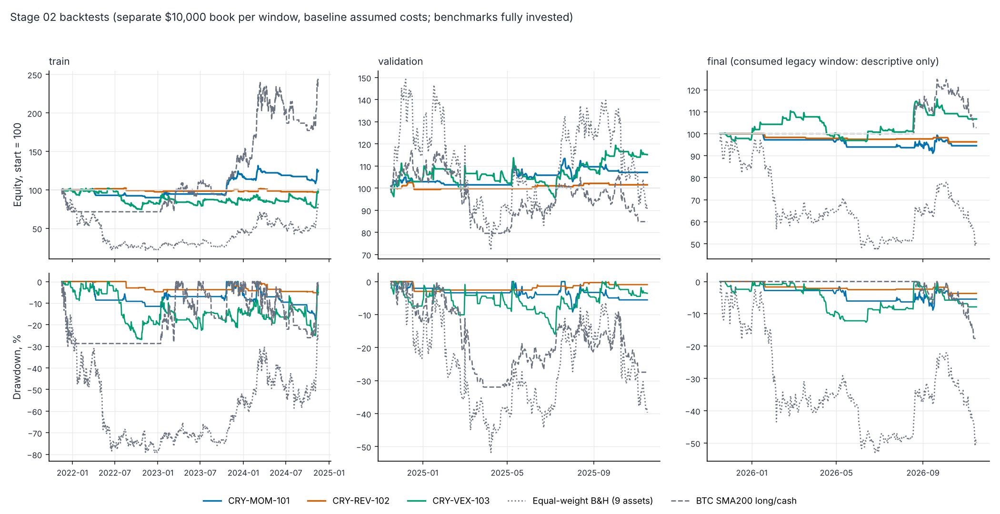

# STAGE 02 — Independent backtest of CRY-MOM-101, CRY-REV-102, CRY-VEX-103

Executed 2021-11-17..2026-11-17 on Binance spot public-archive 1H klines (USDT quote). Code commit `898a4f9f4897`, rules_version `0.1.0-draft` (unchanged from STAGE_01_HANDOFF.v2.json), Python 3.13.18, numpy 2.5.5, pandas 3.1.1. All outputs are deterministic (two consecutive runs gave byte-identical results). Costs are **assumed, not observed** (fee 0.10%, adverse 0.05% per side). The final window is a consumed legacy window: descriptive only. Nothing here is a profitability claim.

**Headline:** none of the three strategies shows statistically credible net edge. Point estimates are small and positive in validation for MOM and VEX, but every 99.17% bootstrap lower bound is below zero, results are fragile to costs and parameters, and the consumed final window is flat-to-negative for MOM and REV. Assessments: **CRY-MOM-101: INVESTIGATE**; **CRY-REV-102: REJECT**; **CRY-VEX-103: INVESTIGATE**.

## A. Reproducible methodology

- **Data (VERIFIED):** `data.binance.vision` monthly 1H spot klines 2021-05..2026-10 plus daily files 2026-11-01..17 for BTC, ETH, SOL, XRP, ADA, LINK, AVAX, DOGE, LTC; 747 files, all SHA-256 verified against Binance's published `.CHECKSUM`; manifest hash `4a66bb17645ff40f…`. Time zone UTC, bar timestamp = open time; microsecond timestamps (2025+) normalised. Venue: Binance spot (the execution venue the user left as '[Specify]' is **still unspecified**; Binance.com API itself returned HTTP 451 from this environment).
- **Code:** `stage02/` (`fetch.py`, `data.py`, `engine.py`, `analysis.py`, `run_full.py`, `run_extra.py`, `make_report.py`); tests `tests/stage02/test_engine.py` (8 synthetic mechanics tests: sizing worked example, stop-first, gap-through fill, next-bar trailing, next-open signal exits, Wilder indicators by hand, 4H invalidation/warm-up reset, future-perturbation invariance of signals). Frozen analysis plan: `docs/strategy-specs/STAGE_02_ANALYSIS_PLAN.md` (committed before any real-data result). Reproduce: `python -m stage02.fetch && python -m stage02.run_full && python -m stage02.run_extra && python -m stage02.make_report`.
- **Execution model:** signal at completed-bar close; market entry at next open; adverse slippage s and fee f per side; initial stop live in entry bar; stop fills at min(stop, open)·(1−s) (gap-through losses can exceed 1R); stop-first on ambiguity; trailing/ratchet effective next bar; SMA20 limit fills only on strict high-through; gap guard; cost-feasibility gate; one-bar cooldown; liquidity gates L1–L3; 1% risk per trade, 3% total open risk, 33% notional cap, 1% of median hourly quote volume participation cap, ≤3 positions, one per symbol; spot, long-only, so **no funding/borrow applies**; spread is inside the adverse-slippage term (no observed spreads); partial fills are **not** modelled beyond the participation cap; cash earns 0.
- **Windows (chronological, fixed before evaluation):** train 2021-11-17→2024-11-17; validation 2024-11-17→2025-11-17; final 2025-11-17→2026-11-17 (`CONSUMED_LEGACY`, descriptive). Each is a fresh $10,000 book; open positions force-closed at the window's last close (counted in `forced_closes`). Warm-up: 1000 consecutive valid bars after any gap.
- **Books:** primary inference = standalone book per strategy; combined book (shared slots/risk, handoff priority order) reported separately.
- **Uncertainty:** circular block bootstrap (14-day blocks, 10,000 resamples, seed 20261118) on sum(P&L)/sum(reserved risk); Sharpe 95% CI by block bootstrap of daily returns; 1000-draw random-entry null.

## B. Metrics by strategy (baseline assumed costs, standalone $10,000 book)

Sharpe/Sortino use daily mark-to-market equity, rf = 0, ×√365. `ratio` = Σnet P&L / Σreserved risk. R = P&L / reserved initial risk (costs included). Exposure = share of hours with ≥1 open position; invested = mean position value / equity; turnover = (buys+sells)/mean equity per year.

### CRY-MOM-101
| window | trades | win | PF | E[R] | median R | ratio | CAGR | ann vol | Sharpe [95% CI] | Sortino | MaxDD | exposure | invested | turnover/yr |
|---|---|---|---|---|---|---|---|---|---|---|---|---|---|---|
| train | 94 | 0.32 | 1.53 | 0.280 | -0.420 | 0.243 | 7.7% | 11.7% | 0.69 [-0.8, 2.0] | 1.22 | -17.6% | 24.3% | 7.9% | 10.2 |
| validation | 49 | 0.47 | 1.40 | 0.152 | -0.195 | 0.138 | 7.1% | 12.7% | 0.60 [-1.0, 2.0] | 0.94 | -9.2% | 33.3% | 11.1% | 15.3 |
| final | 34 | 0.35 | 0.62 | -0.155 | -0.534 | -0.168 | -5.4% | 10.7% | -0.47 [-2.2, 0.7] | -0.72 | -8.9% | 20.5% | 8.8% | 13.4 |

Pooled train+validation: n=143, ratio 0.208, bootstrap 95% CI [-0.126, 0.605], 99.17% one-sided lower bound -0.194. Exit mix (all windows): stops/targets/open-fills/forced = 173 / 0 / 1 / 3. Losses worse than −1R: 1 (gap-through).

### CRY-REV-102
| window | trades | win | PF | E[R] | median R | ratio | CAGR | ann vol | Sharpe [95% CI] | Sortino | MaxDD | exposure | invested | turnover/yr |
|---|---|---|---|---|---|---|---|---|---|---|---|---|---|---|
| train | 40 | 0.47 | 0.79 | -0.074 | -0.032 | -0.075 | -1.0% | 3.7% | -0.25 [-1.3, 0.9] | -0.32 | -5.2% | 2.7% | 0.7% | 5.4 |
| validation | 22 | 0.64 | 1.21 | 0.084 | 0.178 | 0.070 | 1.5% | 3.5% | 0.44 [-1.4, 2.5] | 0.60 | -3.0% | 3.5% | 0.8% | 8.2 |
| final | 11 | 0.36 | 0.27 | -0.402 | -0.431 | -0.367 | -3.7% | 2.8% | -1.35 [-2.4, 0.7] | -1.43 | -4.3% | 2.8% | 0.9% | 5.6 |

Pooled train+validation: n=62, ratio -0.024, bootstrap 95% CI [-0.267, 0.220], 99.17% one-sided lower bound -0.331. Exit mix (all windows): stops/targets/open-fills/forced = 26 / 7 / 40 / 0. Losses worse than −1R: 1 (gap-through).

### CRY-VEX-103
| window | trades | win | PF | E[R] | median R | ratio | CAGR | ann vol | Sharpe [95% CI] | Sortino | MaxDD | exposure | invested | turnover/yr |
|---|---|---|---|---|---|---|---|---|---|---|---|---|---|---|
| train | 724 | 0.29 | 1.00 | 0.033 | -0.516 | 0.001 | 0.1% | 19.8% | 0.10 [-1.4, 1.3] | 0.20 | -26.8% | 20.1% | 10.2% | 151.2 |
| validation | 260 | 0.28 | 1.15 | 0.085 | -0.532 | 0.072 | 15.2% | 25.0% | 0.69 [-1.0, 2.0] | 1.40 | -16.0% | 19.2% | 10.6% | 163.8 |
| final | 172 | 0.35 | 1.13 | 0.128 | -0.411 | 0.058 | 6.7% | 16.9% | 0.47 [-1.8, 2.1] | 1.01 | -12.6% | 13.9% | 8.0% | 113.7 |

Pooled train+validation: n=984, ratio 0.022, bootstrap 95% CI [-0.086, 0.134], 99.17% one-sided lower bound -0.111. Exit mix (all windows): stops/targets/open-fills/forced = 837 / 0 / 318 / 1. Losses worse than −1R: 17 (gap-through).

### Combined book (shared 3 slots / 3% risk; MOM → REV → VEX priority)

| window | trades | ratio | total return | Sharpe | MaxDD | trades MOM/REV/VEX |
|---|---|---|---|---|---|---|
| train | 682 | -0.010 | -5.2% | 0.02 | -30.9% | 91/35/556 |
| validation | 252 | 0.040 | 8.5% | 0.44 | -11.8% | 49/18/185 |
| final | 178 | 0.024 | 3.1% | 0.25 | -13.6% | 32/8/138 |

### Sample sizes and power

Trade counts above are the sample sizes; the R-multiple SD is roughly 1R, so with n≈50–100 the standard error of mean R is about 0.1–0.14R, comparable to the observed point estimates. REV has only 62 pooled train+validation trades (F7 requires 100). Evidence is **weak** for all three; VEX has the largest sample (984 pooled) but a point estimate near zero.

### Performance by calendar year (chained daily returns of the three windows; trades by entry year)

**CRY-MOM-101**

| year | days | return | trades | ratio |
|---|---|---|---|---|
| 2021 | 45 (partial) | 0.0% | 0 | n/a |
| 2022 | 365 | -10.0% | 19 | -0.55 |
| 2023 | 365 | 29.3% | 39 | 0.63 |
| 2024 | 366 | 10.5% | 46 | 0.22 |
| 2025 | 365 | 4.1% | 39 | 0.10 |
| 2026 | 320 (partial) | -5.4% | 34 | -0.17 |

**CRY-REV-102**

| year | days | return | trades | ratio |
|---|---|---|---|---|
| 2021 | 45 (partial) | 0.0% | 0 | n/a |
| 2022 | 365 | -2.5% | 11 | -0.23 |
| 2023 | 365 | 0.3% | 9 | 0.03 |
| 2024 | 366 | -1.3% | 28 | -0.05 |
| 2025 | 365 | 2.1% | 14 | 0.15 |
| 2026 | 320 (partial) | -3.7% | 11 | -0.37 |

**CRY-VEX-103**

| year | days | return | trades | ratio |
|---|---|---|---|---|
| 2021 | 45 (partial) | -1.1% | 16 | -0.07 |
| 2022 | 365 | -16.7% | 227 | -0.10 |
| 2023 | 365 | 4.9% | 225 | 0.03 |
| 2024 | 366 | 19.6% | 293 | 0.09 |
| 2025 | 365 | 8.7% | 238 | 0.05 |
| 2026 | 320 (partial) | 9.7% | 157 | 0.09 |

### Performance by market regime (attribution only; BTC prior-day close vs SMA200 × prior 30-day vol vs 60%)

**CRY-MOM-101**

| regime | share of days | trades | win rate | E[R] | ratio |
|---|---|---|---|---|---|
| DOWN_HIGHVOL | 15.4% | 7 | 0.29 | -0.36 | -0.36 |
| DOWN_LOWVOL | 31.1% | 29 | 0.17 | -0.01 | -0.03 |
| UP_HIGHVOL | 5.9% | 2 | 0.50 | -0.48 | -0.48 |
| UP_LOWVOL | 47.5% | 139 | 0.41 | 0.23 | 0.21 |

**CRY-REV-102**

| regime | share of days | trades | win rate | E[R] | ratio |
|---|---|---|---|---|---|
| DOWN_HIGHVOL | 15.4% | 2 | 1.00 | 0.54 | 0.54 |
| DOWN_LOWVOL | 31.1% | 15 | 0.33 | -0.43 | -0.41 |
| UP_HIGHVOL | 5.9% | 7 | 0.29 | -0.36 | -0.36 |
| UP_LOWVOL | 47.5% | 49 | 0.57 | 0.05 | 0.05 |

**CRY-VEX-103**

| regime | share of days | trades | win rate | E[R] | ratio |
|---|---|---|---|---|---|
| DOWN_HIGHVOL | 15.4% | 170 | 0.26 | -0.15 | -0.14 |
| DOWN_LOWVOL | 31.1% | 300 | 0.31 | 0.13 | 0.10 |
| UP_HIGHVOL | 5.9% | 49 | 0.35 | -0.02 | -0.02 |
| UP_LOWVOL | 47.5% | 637 | 0.30 | 0.09 | 0.05 |

Regime cells with fewer than ~30 trades are not interpretable.

### Sensitivity to trading costs (ratio; multiples scale both fee and slippage)

**CRY-MOM-101**

| cost | train | validation | final |
|---|---|---|---|
| 0.0× | 0.306 | 0.192 | -0.108 |
| 0.5× | 0.274 | 0.165 | -0.140 |
| 1.0× | 0.243 | 0.138 | -0.168 |
| 2.0× | 0.186 | 0.088 | -0.217 |
| 3.0× | 0.134 | 0.043 | -0.260 |
| stressA_fee0.002_adv0.001 | 0.186 | 0.088 | -0.217 |
| stressB_fee0.001_adv0.002 | 0.186 | 0.088 | -0.217 |

**CRY-REV-102**

| cost | train | validation | final |
|---|---|---|---|
| 0.0× | -0.017 | 0.131 | -0.309 |
| 0.5× | -0.047 | 0.098 | -0.339 |
| 1.0× | -0.075 | 0.070 | -0.367 |
| 2.0× | -0.127 | 0.017 | -0.421 |
| 3.0× | -0.170 | -0.094 | -0.274 |
| stressA_fee0.002_adv0.001 | -0.127 | 0.017 | -0.421 |
| stressB_fee0.001_adv0.002 | -0.127 | 0.017 | -0.421 |

**CRY-VEX-103**

| cost | train | validation | final |
|---|---|---|---|
| 0.0× | 0.149 | 0.246 | 0.252 |
| 0.5× | 0.064 | 0.159 | 0.149 |
| 1.0× | 0.001 | 0.072 | 0.058 |
| 2.0× | -0.143 | 0.018 | -0.157 |
| 3.0× | -0.136 | -0.132 | -0.520 |
| stressA_fee0.002_adv0.001 | -0.143 | 0.018 | -0.157 |
| stressB_fee0.001_adv0.002 | -0.140 | -0.025 | -0.179 |

Note: the two handoff stress scenarios have the same total per-side cost (0.30%) but differ for VEX because the pre-registered cost gate `2(f+s)P_f > 0.35(P_f−S0)` uses P_f, which includes slippage; more slippage inflates the denominator and admits more thin-stop trades (96 more VEX candidates in scenario B). This is a property of the registered gate, not a measured effect of slippage.

## C. Equity and drawdown analysis

Daily equity and trade-level evidence are in `stage02/daily_equity_baseline.csv` and `stage02/trades_baseline.csv`. Intra-bar equity is approximated (an exit inside a bar is credited from that bar's first hourly close), so intra-day drawdowns are slightly smoothed.

| strategy | window | max drawdown | peak→trough days | peak→recovery days | longest underwater (days) |
|---|---|---|---|---|---|
| CRY-MOM-101 | train | -17.6% | 245 | not recovered by window end | 573 |
| CRY-MOM-101 | validation | -9.2% | 11 | not recovered by window end | 150 |
| CRY-MOM-101 | final | -8.9% | 303 | not recovered by window end | 304 |
| CRY-REV-102 | train | -5.2% | 807 | not recovered by window end | 821 |
| CRY-REV-102 | validation | -3.0% | 9 | not recovered by window end | 333 |
| CRY-REV-102 | final | -4.3% | 326 | not recovered by window end | 302 |
| CRY-VEX-103 | train | -26.8% | 146 | not recovered by window end | 900 |
| CRY-VEX-103 | validation | -16.0% | 59 | 131 | 158 |
| CRY-VEX-103 | final | -12.6% | 107 | 176 | 175 |

## D. Benchmark comparison

Benchmarks are fully invested (or long/cash) while the strategies' capital is deployed only about 1–11% of the time-weighted equity, so raw returns are **not** like-for-like; Sharpe and drawdown are the fairer comparison, and even those mix very different exposure. Equal-weight and BTC buy-and-hold include entry costs only; the BTC SMA200 benchmark pays costs on each switch. The nine-asset cohort is survivor-selected, which flatters buy-and-hold less than a delisting-free universe would.

| window | series | return | CAGR | ann vol | Sharpe | Sortino | MaxDD |
|---|---|---|---|---|---|---|---|
| train | Equal-weight B&H | -17.1% | -6.0% | 67.3% | 0.25 | 0.34 | -79.2% |
| train | BTC B&H | 50.6% | 14.6% | 55.2% | 0.52 | 0.76 | -73.8% |
| train | BTC SMA200 long/cash | 142.6% | 34.3% | 37.4% | 0.97 | 1.54 | -28.7% |
| train | CRY-MOM-101 | 24.8% | 7.7% | 11.7% | 0.69 | 1.22 | -17.6% |
| train | CRY-REV-102 | -3.0% | -1.0% | 3.7% | -0.25 | -0.32 | -5.2% |
| train | CRY-VEX-103 | 0.3% | 0.1% | 19.8% | 0.10 | 0.20 | -26.8% |
| validation | Equal-weight B&H | -10.0% | -10.0% | 76.5% | 0.24 | 0.35 | -51.8% |
| validation | BTC B&H | 3.9% | 3.9% | 42.4% | 0.30 | 0.43 | -28.1% |
| validation | BTC SMA200 long/cash | -15.1% | -15.1% | 36.9% | -0.26 | -0.36 | -32.0% |
| validation | CRY-MOM-101 | 7.1% | 7.1% | 12.7% | 0.60 | 0.94 | -9.2% |
| validation | CRY-REV-102 | 1.5% | 1.5% | 3.5% | 0.44 | 0.60 | -3.0% |
| validation | CRY-VEX-103 | 15.2% | 15.2% | 25.0% | 0.69 | 1.40 | -16.0% |
| final | Equal-weight B&H | -49.9% | -49.9% | 56.4% | -0.94 | -1.32 | -52.9% |
| final | BTC B&H | -31.3% | -31.3% | 44.2% | -0.63 | -0.88 | -39.5% |
| final | BTC SMA200 long/cash | 2.8% | 2.8% | 19.5% | 0.24 | 0.38 | -17.6% |
| final | CRY-MOM-101 | -5.4% | -5.4% | 10.7% | -0.47 | -0.72 | -8.9% |
| final | CRY-REV-102 | -3.7% | -3.7% | 2.8% | -1.35 | -1.43 | -4.3% |
| final | CRY-VEX-103 | 6.7% | 6.7% | 16.9% | 0.47 | 1.01 | -12.6% |

Random-entry null (identical exits, same count/symbols, 1000 draws; sizing-neutral mean R):

| strategy | window | real mean R | null mean | null p95 | p-value | real > p95 |
|---|---|---|---|---|---|---|
| CRY-MOM-101 | train | 0.280 | 0.411 | 0.807 | 0.699 | no |
| CRY-MOM-101 | validation | 0.152 | 0.057 | 0.342 | 0.291 | no |
| CRY-REV-102 | train | -0.074 | -0.050 | 0.121 | 0.609 | no |
| CRY-REV-102 | validation | 0.084 | -0.115 | 0.144 | 0.102 | no |
| CRY-VEX-103 | train | 0.033 | -0.120 | -0.088 | 0.000 | yes |
| CRY-VEX-103 | validation | 0.085 | -0.109 | -0.052 | 0.000 | yes |

**Null caveat (found after the run, reported as such):** for CRY-VEX-103 the failed-breakout exit is tied to the breakout trigger, so random entries are almost always exited after one bar and pay round-trip costs; the literal null mean (≈−0.11R) is an artefact and the literal F4 pass is **not credible**. A post-hoc diagnostic with that exit leg removed for both real and random entries gives: train real mean R 0.005 vs null p95 -0.006 (exceeds), validation 0.071 vs p95 0.130 (does not exceed, p=0.158), i.e. mixed. Random in-context 1H entries lose to costs on average, so beating them is a low bar.

## E. Bias and data-quality audit

| symbol | rows | missing bars | gap events | duplicates | OHLC violations | zero-volume bars | |1H move| > 20% |
|---|---|---|---|---|---|---|---|
| BTC | 48641 | 7 | 3 | 0 | 0 | 1 | 0 |
| ETH | 48641 | 7 | 3 | 0 | 0 | 1 | 0 |
| SOL | 48641 | 7 | 3 | 0 | 0 | 1 | 2 |
| XRP | 48641 | 7 | 3 | 0 | 0 | 1 | 2 |
| ADA | 48641 | 7 | 3 | 0 | 0 | 1 | 3 |
| LINK | 48641 | 7 | 3 | 0 | 0 | 1 | 1 |
| AVAX | 48641 | 7 | 3 | 0 | 0 | 1 | 4 |
| DOGE | 48641 | 7 | 3 | 0 | 0 | 1 | 4 |
| LTC | 48641 | 7 | 3 | 0 | 0 | 1 | 4 |

- Coverage 2021-05-01 00:00 → 2026-11-17 23:00 UTC, 48,648 hourly slots, 7 missing hours (2021-08-13 01:00 ×4, 2021-09-29 06:00 ×2, 2023-03-24 12:00 ×1), **identical across all nine symbols** (consistent with venue-wide gaps; cause not verified). No duplicates, no non-finite or non-positive prices, no OHLC inequality violations; one zero-volume hour per symbol (also shared).
- The >20% hourly moves are **flagged, not removed**: several coincide across symbols on the same hour (e.g. 2021-05-19 12:00, 2022-05-11 12:00); single-symbol cases were not independently verified against a second source. The handoff said invalid data blocks a run; these are extreme-but-valid-looking prints, so a judgement call that is disclosed here. No second data source cross-check was performed.
- **Warm-up consequence:** because any missing hour invalidates a 4H bar and resets warm-up to 1000 bars (≈167 days at 4H), MOM/REV could not signal between 2021-09-29 and ~2022-03-15 or between 2023-03-24 and ~2023-09-06; share of bars eligible by structure (valid, warm, liquid, trend/context) per window: CRY-MOM-101: 19.3%/26.9%/20.7%; CRY-REV-102: 33.3%/48.4%/29.0%; CRY-VEX-103: 42.7%/47.2%/32.4% (train/validation/final). A 400-bar warm-up sensitivity gave similar ratios (see results.json `warmup_400_sensitivity`).
- **Look-ahead:** signals use completed bars only; entry at next open; 4H context for VEX uses the last 4H bar whose close ≤ the 1H close; daily liquidity uses completed UTC days; a synthetic test confirms signals are invariant to perturbing future bars. Stop/target exits free capital only at the end of their bar. Parameters were not tuned and rules were not changed after seeing results.
- **Constraint audit:** 2518 trades checked across all books/windows: violations of 33% notional cap 0, 1% per-trade risk 0, max 3 positions 0, 3% total open risk 0. Equity reconciles to Σ trade P&L in every run; entry prices hand-checked against raw bars.
- **Survivorship (NOT eliminated):** the nine-asset cohort was chosen retrospectively from assets that survived; delisted/failed assets are UNAVAILABLE. Results for alts are therefore biased upward in expectation.
- **Data leakage / reuse:** the final window was already consumed by legacy Stage 02 work, and the cohort and thresholds were designed knowing the 2021–2026 history in general terms; the train/validation split gives **no** untouched out-of-sample test. Counting this family as 6 hypotheses, 3 were evaluated here with a handful of single-parameter neighbours and ablations, none used to select a variant.
- **Costs/venue (UNAVAILABLE / ASSUMED):** historical fee tier, spread, depth, lot/tick/min-notional filters, venue status and USDT/USD conversion were not observed; lot step 1e-6 and min notional 10 USDT are assumptions; slippage is a flat 0.05% regardless of volatility or size, which understates costs in fast markets and for thin alts. Partial fills, outages and API/latency effects are not modelled. Shorts, funding and borrow are out of scope (spot, long-only).
- **Formal adjudication not run:** `research/validation/adjudicate.py` requires a frozen preregistration, which in this ledger needs an independent recorded review that this session cannot supply. The three hypotheses are registered (ledger state REGISTERED) but not frozen; the labels below are research assessments only.

## F. Pass / Investigate / Reject research assessment

Rule (declared in the frozen plan): REJECT if F1 fails, pooled train+validation ratio ≤ 0, or a strategy-specific falsifier triggers; PASS-CONDITIONAL only if every gate passes (and never unconditional, because costs/venue/survivorship are unobserved); otherwise INVESTIGATE.

### CRY-MOM-101 — **INVESTIGATE**

| gate | result |
|---|---|
| F1 validation ratio > 0 | pass |
| F2 ratio > 0 under both cost stresses (validation) | pass |
| F3 99.17% bootstrap lower bound > 0 (validation) | FAIL |
| F4 real mean R > null p95 (validation, literal) | FAIL |
| F5 fewer than half of neighbours <= 0 (3/4 <= 0) | FAIL |
| F6 ratio > 0 after dropping best 5% trades (validation) | FAIL |
| F7 pooled train+validation trades >= 100 | pass |
| F8 >= 2 of 3 subperiods positive | pass |
| F9 placebo_M<=0 does not match/beat real rule (validation) | pass |

### CRY-REV-102 — **REJECT**

| gate | result |
|---|---|
| F1 validation ratio > 0 | pass |
| F2 ratio > 0 under both cost stresses (validation) | pass |
| F3 99.17% bootstrap lower bound > 0 (validation) | FAIL |
| F4 real mean R > null p95 (validation, literal) | FAIL |
| F5 fewer than half of neighbours <= 0 (1/4 <= 0) | pass |
| F6 ratio > 0 after dropping best 5% trades (validation) | FAIL |
| F7 pooled train+validation trades >= 100 | FAIL |
| F8 >= 2 of 3 subperiods positive | FAIL |
| F9 no_SMA300_filter does not match/beat real rule (validation) | pass |
| F10 5 worst losses < gross profit (pooled) | pass |

### CRY-VEX-103 — **INVESTIGATE**

| gate | result |
|---|---|
| F1 validation ratio > 0 | pass |
| F2 ratio > 0 under both cost stresses (validation) | FAIL |
| F3 99.17% bootstrap lower bound > 0 (validation) | FAIL |
| F4 real mean R > null p95 (validation, literal) | pass |
| F5 fewer than half of neighbours <= 0 (0/6 <= 0) | pass |
| F6 ratio > 0 after dropping best 5% trades (validation) | FAIL |
| F7 pooled train+validation trades >= 100 | pass |
| F8 >= 2 of 3 subperiods positive | pass |
| F9 no_volume_condition does not match/beat real rule (validation) | pass |

**CRY-MOM-101 summary:** Validation and train point estimates are positive and survive both cost stresses, and the placebo (M≤0) entries do worse, but the 99.17% lower bound is below zero, the real rule does not beat the random-entry null, three of four parameter neighbours are ≤0 in validation, dropping the best 3 trades makes the ratio negative, and the consumed final window is negative. Treat as **weak, possibly noise**; worth investigating only with an independent sample (forward paper, adjacent assets) before any further use.

**CRY-REV-102 summary:** Only 119 raw signals / 62 pooled trades; pooled ratio slightly negative, one of three subperiods positive, train negative, final window strongly negative. The REJECT is rule-based on a **small, inconclusive sample** (F7): this test cannot prove the absence of an edge, only that none is demonstrated. The no-trend-filter ablation is clearly worse, which supports the regime filter but not profitability.

**CRY-VEX-103 summary:** Largest sample (984 pooled trades) with an expectancy near zero (pooled ratio ≈ +0.02); validation/final positive but train flat, cost-fragile (ratio negative in train and final under both handoff stress scenarios and in validation under stress B; negative at 3× costs in every window), 99.17% lower bound below zero, outlier-dependent (dropping the best 13 trades turns validation negative), turnover ≈110–165×/yr. The literal random-entry test is degenerate (see Section D). Weak evidence; costs dominate.

No strategy is ranked as profitable. The ordering of labels is a statement about falsification gates, not expected returns.

## G. STAGE_02_HANDOFF

Machine-readable: `docs/strategy-specs/STAGE_02_HANDOFF.json` (metrics, evidence file hashes, windows, limitations, unresolved items).
