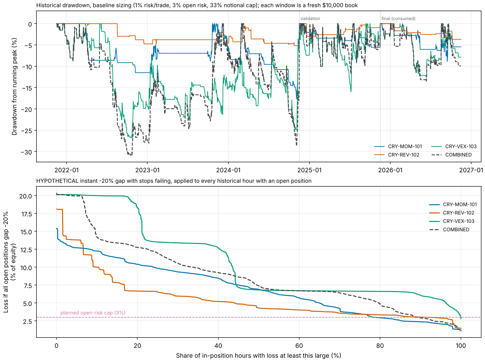

# STAGE 03 — Quantitative risk assessment of CRY-MOM-101, CRY-REV-102, CRY-VEX-103

Created 2026-11-18 from `STAGE_01_HANDOFF.v2.json` and `STAGE_02_HANDOFF.json` (rules_version 0.1.0-draft, unchanged). Code commit `584195947467` (stage02/stage03 source dirty at run: False). Research only: no orders, credentials or execution. All numbers come from `docs/strategy-specs/stage03/risk_results.json`, produced by `stage03/run_stage03.py` on the Stage 02 trade engine; the engine trades reconcile exactly to `stage02/trades_baseline.csv` (reconciliation_ok = True).

**Labels used throughout.** **[H] Historical** = measured in the 2021-11-17..2026-11-17 backtest trades/hourly books (costs ASSUMED, not observed; the final year is `CONSUMED_LEGACY`). **[S] Simulated** = an explicitly stated hypothetical rule applied to historical exposures or an engine re-run; not a forecast. **[U] Unquantified** = cannot be estimated from this data; no probability is given. Assessments are research labels, not `adjudicate.py` dispositions (the ledger is not frozen; see Stage 02).

## Headline

1. **Planned risk and real tail exposure differ by a large factor.** The book is built to risk 1% per trade and 3% open, but CRY-VEX-103 is notional-cap-bound: 74% of its train trades risk less than 1% because the 33% position cap binds, so three positions mean ~100% gross exposure (max 100%). A [S] instant −20% gap with stops failing would cost VEX/combined up to **20.3% of equity** (MOM 15.4%, REV 18.1%) against a 3% planned open-risk cap.
2. **VEX has almost no stop-fill slack.** Its pooled net P&L vanishes if stops fill only **9 bp** worse (mean) than modelled (train: 0.2 bp), while the exit bar's wick below the stop averages ~81 bp. MOM tolerates ~93 bp; REV has none. Real stop slippage is **[U]**: OHLC bars cannot show it.
3. **Ten consecutive losses is routine, not a tail event, for MOM and VEX.** Loss share is 63% / 70%; observed runs of ≥10 losses: MOM 3, VEX 16; longest runs 18 and 22. Runs cluster more than an independent-trials model predicts, so "10 losses" cannot serve as a halt rule by itself.
4. **Historical max drawdown at baseline sizing:** MOM -17.6% (train), VEX -26.8%, shared three-strategy book -30.9%. These all came with ≤3% planned open risk.
5. **Risk modifications cut drawdown by cutting exposure; none is shown to improve return per unit risk.** Where tested (development windows only) P&L falls roughly in proportion. Efficiency ideas are hypotheses, not findings.
6. **Eligibility:** MOM — continue (reduced budget, paper/forward only); VEX — conditional (shadow/paper until observed fill evidence exists); REV — shadow only, 0% budget. None is cleared for capital.

## Methodology (risk layer)

- **Inputs:** the Stage 02 standalone $10,000 books (one per strategy, train/validation/final) re-run through the unchanged engine, plus the Stage 02 shared three-strategy book (`COMBINED`). Sizing, signals, costs and rules are untouched; every scenario below is a post-processing or a labelled re-run.
- **Risk per trade** = reserved risk q·d (stop distance plus fees/slippage), in $ and % of entry-time equity. **R** = net P&L / reserved risk. **Planned R:R** is defined only where a target exists (REV: SMA20 target, gross (target − O1)/(O1 − S0)); MOM/VEX use trailing exits, so planned R:R is **not defined** — only realised R:R (avg win R / |avg loss R|) is reported.
- **VaR/ES:** historical simulation on daily mark-to-market book returns pooled across the three windows (1826 days; windows are separate books so returns are %-based). 95% and 99%, 1-day, rf = 0, stated as positive loss fractions. Gaussian VaR/ES shown as a comparator only. 95% CIs by circular block bootstrap (14-day blocks, 2,000 resamples, seed 20261118). 99% has only 19 tail days and is flagged limited; 99.9% is **not** reported. A 7-day overlapping-window 95% figure is given with its dependence caveat. A second version conditional on days with an open position is given because 44–95% of days are flat.
- **Extreme-condition exposure:** conditions from the cohort (equal-weight of the nine assets): worst 5% of days (92 days, daily return ≤ -5.7%) and BTC high-volatility regime days (30-day annualised vol > 60%).
- **Gap shock [S]:** at the close of every historical hour with an open position, mark every position down by x%, fill at the gapped price × (1 − slippage) less fee; report loss as % of that hour's equity. This is exposure arithmetic: it ignores stop levels because the premise is that stops fail.
- **Stop-fill bound [S on H bars]:** for each stop exit, the loss if the stop fills at a fraction α of the way from the modelled fill to the exit bar's low (α = 0.5, 1.0; excursion ×2 for the volatility-doubles case). α = 1 is a worst-case bound, not an expectation.
- **Venue-unavailable freeze [S]:** positions cannot be exited for T hours (24/72/168); loss = worst adverse excursion (exit at the trough of the next T hours, less fee/slippage) versus the mark.
- **Engine re-runs [S]:** volatility ×2 (every bar's log-return deviation from its linear trend doubled, intrabar ranges doubled; quote volume unchanged), costs ×3, volume ×0.1 (alone, and with 4× slippage). Whole-book re-runs, including the cost gate and liquidity gates.
- **Variants M1–M3 and policy replay are exploratory sensitivities on the development/evaluation/consumed windows with one pre-declared configuration each (not selected on performance, not registered as new hypotheses, not preregistered). They cannot support a performance claim.** The throttle (M3) is a linear-scaling replay of closed-trade equity, not a re-simulation.
- **Adequacy rules applied:** no tail probability is inferred from the trade samples (MOM n = 177, REV n = 73, VEX n = 1156); independent-trials expectations for loss runs are printed as ILLUSTRATIVE only.

## A. Risk dashboard

### CRY-MOM-101
| window | trades | risk/trade median $ / %E (max %E) | notional %E median / max | stop distance median | planned R:R | realised R:R | avg win / avg loss | expectancy $ (R) | win rate |
|---|---|---|---|---|---|---|---|---|---|
| train | 94 | $113 / 1.00% (max 1.00%) | 14% / 29% | 6.8% | undefined (trailing exit) | 3.45 | $238 / -$73 | $26 (0.280R) | 32% |
| validation | 49 | $105 / 1.00% (max 1.00%) | 13% / 33% | 7.2% | undefined (trailing exit) | 1.64 | $108 / -$68 | $15 (0.152R) | 47% |
| final | 34 | $95 / 1.00% (max 1.00%) | 19% / 33% | 5.1% | undefined (trailing exit) | 1.18 | $74 / -$65 | -$16 (-0.155R) | 35% |

| window | MaxDD daily MTM | MaxDD hourly | recovered | longest underwater | time in market / avg invested | gross exposure max / p99 (% equity) | max open reserved risk | max open positions |
|---|---|---|---|---|---|---|---|---|
| train | -17.6% | -19.0% | not within window | 573d | 24% / 7.9% | 66% / 63% | 3.1% | 3 |
| validation | -9.2% | -10.3% | not within window | 150d | 33% / 11.1% | 68% / 67% | 3.1% | 3 |
| final | -8.9% | -9.1% | not within window | 304d | 20% / 8.8% | 77% / 69% | 3.1% | 3 |

### CRY-REV-102
| window | trades | risk/trade median $ / %E (max %E) | notional %E median / max | stop distance median | planned R:R | realised R:R | avg win / avg loss | expectancy $ (R) | win rate |
|---|---|---|---|---|---|---|---|---|---|
| train | 40 | $99 / 1.00% (max 1.00%) | 19% / 33% | 5.1% | 1.28 (n=40) | 0.88 | $60 / -$69 | -$7 (-0.074R) | 48% |
| validation | 22 | $101 / 1.00% (max 1.00%) | 16% / 33% | 5.9% | 1.47 (n=22) | 0.72 | $62 / -$89 | $7 (0.084R) | 64% |
| final | 11 | $98 / 1.00% (max 1.00%) | 25% / 33% | 3.7% | 1.42 (n=11) | 0.43 | $34 / -$72 | -$34 (-0.402R) | 36% |

| window | MaxDD daily MTM | MaxDD hourly | recovered | longest underwater | time in market / avg invested | gross exposure max / p99 (% equity) | max open reserved risk | max open positions |
|---|---|---|---|---|---|---|---|---|
| train | -5.2% | -5.2% | not within window | 821d | 3% / 0.7% | 72% / 29% | 3.1% | 3 |
| validation | -3.0% | -5.3% | not within window | 333d | 3% / 0.8% | 50% / 27% | 3.1% | 3 |
| final | -4.3% | -4.5% | not within window | 302d | 3% / 0.9% | 90% / 33% | 2.6% | 3 |

### CRY-VEX-103
| window | trades | risk/trade median $ / %E (max %E) | notional %E median / max | stop distance median | planned R:R | realised R:R | avg win / avg loss | expectancy $ (R) | win rate |
|---|---|---|---|---|---|---|---|---|---|
| train | 724 | $69 / 0.78% (max 1.00%) | 33% / 33% | 2.1% | undefined (trailing exit) | 2.56 | $111 / -$46 | $0 (0.033R) | 29% |
| validation | 260 | $84 / 0.78% (max 1.00%) | 33% / 33% | 2.1% | undefined (trailing exit) | 3.01 | $161 / -$55 | $6 (0.085R) | 28% |
| final | 172 | $66 / 0.63% (max 1.00%) | 33% / 33% | 1.7% | undefined (trailing exit) | 2.34 | $96 / -$47 | $4 (0.128R) | 35% |

| window | MaxDD daily MTM | MaxDD hourly | recovered | longest underwater | time in market / avg invested | gross exposure max / p99 (% equity) | max open reserved risk | max open positions |
|---|---|---|---|---|---|---|---|---|
| train | -26.8% | -28.6% | not within window | 900d | 20% / 10.2% | 100% / 100% | 3.0% | 3 |
| validation | -16.0% | -16.5% | yes, 131d peak→recovery | 158d | 19% / 10.6% | 101% / 100% | 3.0% | 3 |
| final | -12.6% | -14.9% | yes, 176d peak→recovery | 175d | 14% / 8.0% | 101% / 100% | 2.8% | 3 |

### COMBINED (shared book: all three rule sets, shared slots/risk)
| window | trades | risk/trade median $ / %E (max %E) | notional %E median / max | stop distance median | planned R:R | realised R:R | avg win / avg loss | expectancy $ (R) | win rate |
|---|---|---|---|---|---|---|---|---|---|
| train | 682 | $77 / 0.86% (max 1.00%) | 33% / 33% | 2.4% | 1.30 (n=35) | 2.47 | $116 / -$50 | -$1 (0.018R) | 30% |
| validation | 252 | $90 / 0.85% (max 1.00%) | 33% / 33% | 2.3% | 1.51 (n=18) | 2.30 | $126 / -$58 | $3 (0.070R) | 33% |
| final | 178 | $70 / 0.69% (max 1.00%) | 33% / 33% | 1.8% | 1.42 (n=8) | 2.33 | $92 / -$48 | $2 (0.119R) | 35% |

| window | MaxDD daily MTM | MaxDD hourly | recovered | longest underwater | time in market / avg invested | gross exposure max / p99 (% equity) | max open reserved risk | max open positions |
|---|---|---|---|---|---|---|---|---|
| train | -30.9% | -32.6% | yes, 645d peak→recovery | 644d | 39% / 16.1% | 100% / 100% | 3.1% | 3 |
| validation | -11.8% | -12.5% | yes, 68d peak→recovery | 117d | 46% / 19.0% | 100% / 99% | 3.1% | 3 |
| final | -13.6% | -15.9% | yes, 176d peak→recovery | 175d | 32% / 15.9% | 101% / 99% | 3.1% | 3 |

**Reading:** risk per trade is at the 1% budget except where the 33% notional cap binds (VEX, REV in tight-stop regimes); reserved open risk never exceeded 3.1% of hourly equity (3% of entry equity). Gross exposure is the quantity that carries gap risk, and for VEX/combined it reaches ~100% of equity.

**Table A2 — 1-day VaR/ES (positive = loss), pooled three windows, historical simulation [H]**

| book | 95% VaR / ES | 95% bootstrap CI (VaR / ES) | 99% VaR / ES (limited: 19 tail days) | Gaussian 95% VaR / ES (comparator) | 95% VaR / ES on invested days only | 7-day 95% VaR / ES (overlapping) | worst 1d / 7d | flat days |
|---|---|---|---|---|---|---|---|---|
| CRY-MOM-101 | 0.69% / 1.42% | [0.52%, 0.93%] / [1.14%, 1.66%] | 1.99% / 2.48% | 0.99% / 1.25% | 1.64% / 2.30% (n=508d) | 2.0% / 3.1% | -3.4% / -6.5% | 72% |
| CRY-REV-102 | -0.00% / 0.02% | [-0.00%, 0.00%] / [0.19%, 0.48%] | 0.53% / 1.24% | 0.30% / 0.38% | 1.65% / 2.24% (n=93d) | 0.5% / 1.5% | -3.0% / -3.0% | 95% |
| CRY-VEX-103 | 1.22% / 1.86% | [1.09%, 1.33%] / [1.67%, 2.07%] | 2.22% / 3.04% | 1.74% / 2.19% | 1.69% / 2.46% (n=764d) | 3.2% / 4.6% | -4.5% / -9.0% | 58% |
| COMBINED | 1.44% / 2.14% | [1.29%, 1.61%] / [1.95%, 2.34%] | 2.61% / 3.30% | 1.86% / 2.33% | 1.81% / 2.56% (n=1018d) | 3.8% / 5.2% | -5.2% / -9.8% | 44% |

REV's unconditional 95% VaR is 0 because it is flat on ~95% of days; use the invested-day column. The Gaussian comparator understates the 99% historical tail for MOM and REV (fat tails). VaR/ES on daily returns do not capture gap, stop-failure or venue risk — see section B.

**Table A3 — consecutive-loss distribution [H]** (loss = net P&L ≤ 0, trades ordered by exit; each window is its own sequence, pooled)

| book | trades | loss share | loss runs | longest | runs ≥5 / ≥8 / ≥10 | independent-trials expectation of ≥10 runs (ILLUSTRATIVE only) | costliest run | histogram length:count |
|---|---|---|---|---|---|---|---|---|
| CRY-MOM-101 | 177 | 63% | 32 | 18 | 5 / 3 / 3 | 0.7 | -13.5R / -$1,568 | 1:12, 2:4, 3:5, 4:6, 5:1, 6:1, 10:1, 14:1, 18:1 |
| CRY-REV-102 | 73 | 49% | 16 | 5 | 1 / 0 / 0 | 0.0 | -4.0R / -$405 | 1:6, 2:4, 3:3, 4:2, 5:1 |
| CRY-VEX-103 | 1156 | 70% | 215 | 22 | 60 / 30 / 16 | 9.8 | -13.6R / -$892 | 1:64, 2:46, 3:26, 4:19, 5:15, 6:6, 7:9, 8:7, 9:7, 10:3, 11:4, 12:2, 13:2, 14:1, 15:2, 16:1, 22:1 |
| COMBINED | 1112 | 69% | 204 | 23 | 56 / 26 / 13 | 8.1 | -11.0R / -$945 | 1:60, 2:44, 3:27, 4:17, 5:13, 6:7, 7:10, 8:7, 9:6, 11:3, 12:3, 13:2, 14:1, 15:1, 16:2, 23:1 |

Observed ≥10-loss runs exceed the independent-trials expectation for both MOM and VEX (losses cluster in downtrends and chop). With 18–23 loss runs in a five-year sample, the sample is too small to estimate the probability of a longer run.

**Table A4 — gap, slippage and liquidity [H measured; wick columns are bounds [S]]**

| book | stop exits | worst modelled trade | wick below stop fill, exit bar: median / p95 / max (% of price) | stop-at-bar-low: share worse than −1.5R / −2R | worst R at bar-low fill | entry notional ÷ entry-bar volume p99 / max | exit notional ÷ exit-bar volume p99 / max | max entry notional ÷ 168h median hourly volume (cap 1%) |
|---|---|---|---|---|---|---|---|---|
| CRY-MOM-101 | 173 | -1.000R | 0.76% / 6.5% / 18.1% | 3% / 1% | -2.1R | 0.04% / 0.06% | 0.03% / 0.18% | 0.18% |
| CRY-REV-102 | 26 | -1.000R | 1.14% / 8.6% / 10.5% | 31% / 12% | -3.9R | 0.04% / 0.06% | 0.12% / 0.16% | 0.26% |
| CRY-VEX-103 | 837 | -1.000R | 0.43% / 2.8% / 11.3% | 11% / 4% | -4.7R | 0.22% / 0.63% | 0.37% / 0.98% | 0.64% |
| COMBINED | 823 | -1.000R | 0.46% / 3.0% / 18.1% | 8% / 3% | -3.9R | 0.21% / 0.60% | 0.36% / 0.88% | 0.61% |

- **No material gap-through in the model.** Every modelled trade lost ≤1.000R (float noise only) because the largest 1H log move in the data is 30.0% (all assets) and stops fill at min(stop, open)·(1−s): spot crypto trades continuously, so "gaps" appear as in-bar wicks, which the model fills at the stop plus a fixed 5 bp. That is an assumption, not an observation.
- **Wick evidence (bounds, not expectations):** exit bars wick a median 0.43% (VEX) – 0.76% (MOM) of price below the modelled stop fill and up to 18%; VEX's median stop distance is only 2.1%.
- **Liquidity (measured against the assumed 1%-of-median-volume cap):** the cap bound on 0% of trades; the largest position was 0.63% of its entry bar's quote volume. At $10,000 these sizes are small; they do not describe a larger account, a thin hour, or a stress when volume collapses (scenario S4).

**Table A5 — correlated-signal concentration and extreme-condition exposure [H]**

| book | trades entered the same hour as another | candidates with a simultaneous candidate | entries blocked (symbol occupied / slots / cooldown) | max losing exits in 24h / worst 24h exit cluster | mean gross exposure on worst-5% cohort days | on high-vol days | on other days | worst day return on worst-5% cohort days |
|---|---|---|---|---|---|---|---|---|
| CRY-MOM-101 | 18% | 79% | symbol_occupied:3126, max_positions:1141, cooldown:57 | 3 / -$278 | 5% (max day 52%) | 2% (max 49%) | 11% | -3.4% |
| CRY-REV-102 | 45% | 48% | symbol_occupied:18, max_positions:4, cooldown:3 | 3 / -$305 | 2% (max day 48%) | 0% (max 38%) | 1% | -3.0% |
| CRY-VEX-103 | 33% | 48% | cooldown:12, symbol_occupied:479, max_positions:404 | 6 / -$340 | 3% (max day 58%) | 10% (max 94%) | 11% | -3.6% |
| COMBINED | 34% | 71% | cooldown:70, symbol_occupied:3773, max_positions:1695 | 6 / -$315 | 9% (max day 61%) | 12% (max 94%) | 19% | -5.2% |

- **Cohort correlation:** mean pairwise daily-return correlation of the nine assets 0.69 over the full window (rolling 30-day: median 0.74, 95th pct 0.90, max 0.92); first principal component 72% of variance. Restricted to the worst-5% cohort days the average is 0.57; conditioning on extreme days restricts the range and biases correlation estimates, so this is not evidence that correlations do not rise in a crash.
- **Effective diversification is low:** up to three positions in nine highly co-moving assets, one position per symbol. 18% of days have ≥2 of the three strategies invested; standalone-book daily-return correlations: MOM~VEX 0.26, MOM~REV 0.10, REV~VEX -0.02; MOM and VEX held the same symbol at overlapping times in 138 trade pairs.
- **Trend strategies sat out the worst days:** on the worst-5% cohort days mean gross exposure is 5% (MOM) / 3% (VEX) versus 11% / 11% on other days. That is flat-market luck as much as design: the worst single-day exposure on such a day was still 58%.
- **Skipped entries:** because only one position per symbol and three slots are allowed, most simultaneous signals are discarded (MOM: 3126 symbol-occupied and 1141 slot-blocked entries), so realised concentration understates signal concentration.

## B. Scenario stress-test matrix

Type: **[H]** historical replay, **[S]** simulated/hypothetical, **[U]** unquantified. 'Pooled' = train+validation+final (final is consumed; descriptive). Baseline pooled results for reference are in the first row.

| scenario | CRY-MOM-101 | CRY-REV-102 | CRY-VEX-103 | COMBINED |
|---|---|---|---|---|
| Baseline (assumed costs) [H] | $2,647; ratio 0.142; worst-window MaxDD -17.6%; n=177 | -$515; ratio -0.072; worst-window MaxDD -5.2%; n=73 | $2,217; ratio 0.027; worst-window MaxDD -26.8%; n=1156 | $644; ratio 0.008; worst-window MaxDD -30.9%; n=1112 |
| S1a Worst cohort day 2022-11-09 (cohort −19.2%) [H] | flat (no position) | flat (no position) | flat (no position) | flat (no position) |
| S1b Worst cohort 7 days 2022-05-05..11 (cohort −39.1%) [H] | flat (no position) | flat (no position) | -2.1%; max gross 99% | -2.1%; max gross 99% |
| S1c Instant −20% gap, stops fail: loss % equity, in-position hours max / p99 [S] | 15.4% / 13.6%; >3% in 79% of hours | 18.1% / 18.1%; >3% in 91% of hours | 20.3% / 20.1%; >3% in 100% of hours | 20.2% / 20.1%; >3% in 89% of hours |
| S1d same, plus 2% extra exit slippage [S] | 16.6% / 14.7% | 19.5% / 19.5% | 21.9% / 21.7% | 21.8% / 21.7% |
| S2a Volatility ×2, whole-book re-run (sizing adapts) [S]; return not interpretable | $5,443; ratio 0.558; worst-window MaxDD -8.9%; n=87 | -$19; ratio -0.003; worst-window MaxDD -4.8%; n=64 | $20,944; ratio 0.148; worst-window MaxDD -27.9%; n=1244 | $21,342; ratio 0.143; worst-window MaxDD -29.7%; n=1244 |
| S2b Stops fill at 50% of in-bar wick [S on H bars]: pooled net P&L; share of stops worse than −1.5R | $328; 0.6% | -$1,118; 11.5% | -$7,562; 2.7% | -$8,126; 2.6% |
| S2c Stops fill at exit-bar low (worst-case bound) [S] | -$1,991; 3%; worst -2.1R | -$1,721; 31%; worst -3.9R | -$17,340; 11%; worst -4.7R | -$16,896; 8%; worst -3.9R |
| S2d Wick depth ×2 and fill at bar low (post-entry vol shock, stops sized before) [S] | -$6,630; worst -3.1R | -$2,927; worst -6.9R | -$36,897; worst -8.5R | -$34,436; worst -6.9R |
| S3 Execution costs ×3 (fee 0.30%, slippage 0.15% per side) [S] | $689; ratio 0.038; worst-window MaxDD -18.0%; n=177 | -$1,039; ratio -0.160; worst-window MaxDD -7.8%; n=66 | -$5,922; ratio -0.161; worst-window MaxDD -43.5%; n=443 | -$6,599; ratio -0.146; worst-window MaxDD -41.3%; n=539 |
| S4a Quote volume ×0.1 (liquidity gates + 1% participation cap) [S] | $1,830; ratio 0.137; worst-window MaxDD -12.5%; n=131 | -$667; ratio -0.127; worst-window MaxDD -5.0%; n=54 | -$414; ratio -0.011; worst-window MaxDD -17.5%; n=586 | $167; ratio 0.003; worst-window MaxDD -17.2%; n=644 |
| S4b Volume ×0.1 and slippage ×4 [S] | $1,001; ratio 0.076; worst-window MaxDD -12.6%; n=131 | -$963; ratio -0.181; worst-window MaxDD -5.8%; n=54 | -$5,643; ratio -0.194; worst-window MaxDD -33.5%; n=367 | -$5,440; ratio -0.138; worst-window MaxDD -34.1%; n=469 |
| S5a Ten losses in a row at −1R each, compounding [S] | −9.5% equity | −9.4% equity | −7.2% equity | −7.6% equity |
| S5b Ten losses at the mean stop-loss size if stops fill at bar low [S] | −7.8% (-0.81R each) | −13.0% (-1.41R each) | −7.5% (-1.03R each) | −7.4% (-0.97R each) |
| S5c Observed: longest losing run, its cost, runs ≥10 [H] | 18 losses; -13.5R / -$1,568; 3 runs ≥10 | 5 losses; -4.0R / -$405; 0 runs ≥10 | 22 losses; -13.6R / -$892; 16 runs ≥10 | 23 losses; -11.0R / -$945; 13 runs ≥10 |
| S6 Venue unreachable 24h, no exits possible: worst loss % equity max / p99 [S] | 10.9% / 4.3% | 5.7% / 5.0% | 20.2% / 7.7% | 20.2% / 6.1% |
| S6 Venue unreachable 72h, no exits possible: worst loss % equity max / p99 [S] | 10.9% / 6.6% | 7.1% / 5.6% | 26.0% / 12.1% | 30.3% / 9.6% |
| S6 Venue unreachable 168h, no exits possible: worst loss % equity max / p99 [S] | 10.9% / 8.1% | 10.3% / 8.5% | 42.1% / 22.1% | 42.1% / 15.6% |
| S6x Exchange insolvency, withdrawal freeze, delisting, USDT depeg [U] | exposure up to the venue balance; no probability estimable | exposure up to the venue balance; no probability estimable | exposure up to the venue balance; no probability estimable | exposure up to the venue balance; no probability estimable |

**Notes on the matrix**

- **S1 (−20% decline).** No day in the sample reached −20% for the equal-weight cohort (worst −19.2% on 2022-11-09; 17 days ≤ −10%, 6 ≤ −15%); the worst 7-day cohort decline was −39.1% and the worst 14-day −42.4%. In both replays MOM and REV were flat; VEX/combined were flat on 2022-11-09 and lost 2.1% over the 7-day window (a historical outcome, not a guarantee). The hypothetical instant gap is the informative row: planned open risk is ≤3%, but loss under a gap scales with **gross exposure**, so VEX/combined can lose ~20% and MOM up to ~15%. With continuously working stops the loss would be near the planned risk; the gap is the stop-failure case.
- **S2 (volatility doubles).** The transformation doubles every deviation from trend, which also amplifies multi-week trends (BTC min/max price ratio 8.1→61), so the large P&L increases for trend rules are an artefact and must not be read as "volatility helps". What is informative: ATR sizing halves position size, so MOM's MaxDD *fell* (-8.9% vs -17.6%) while VEX stayed capped by notional (-27.9%). The unanticipated-shock version (S2b–S2d), where stops are sized before the volatility rises, is the harsher and more relevant test.
- **S2b–S2d (stops failing inside bars).** If stops filled at the exit-bar low the pooled net P&L would be -$17,340 (VEX) and -$1,991 (MOM); the bar-low case is a bound. The **fill tolerance** is the useful number: net P&L reaches zero when stops fill an average of 93 bp (MOM; validation 97), 9 bp (VEX; validation 26, train 0.2) worse than modelled; REV is already negative pooled, and the combined book has ≈3 bp pooled and none in train. Drawdowns under S2c exceed −100% of the additive $10,000 base for VEX/combined ("wipe-out" in the bound).
- **S3 (costs ×3).** The VEX cost gate removes 713 of 1,156 trades, yet net P&L is -$5,922 and train MaxDD -43.5%. VEX cost is 99% / 63% / 73% of gross P&L in train / validation / final even at baseline costs. MOM is the least cost-sensitive (ratio 0.038 at ×3).
- **S4 (liquidity).** Scaling volume to 10% removes 1679 MOM and 1236 VEX candidates through the liquidity gates; trades survive in the most liquid assets, so MaxDD can fall simply because there is less trading. Adding 4× slippage drives VEX to ratio -0.194 and train MaxDD -33.5%. The engine has no market-impact function; impact on exit under a real liquidity shock is [U].
- **S5 (ten losses).** Ten −1R losses cost ≈ 7–10% of equity at baseline sizing, but this is not a tail case: MOM lost 18 in a row (-13.5R, -$1,568) and VEX 22 in a row. The 3% open-risk cap bounds *simultaneous* losses, not sequential ones.
- **S6 (venue unavailable).** The three gaps in the data (2021-08-13 02:00–05:00, 2021-09-29 07:00–08:00, 2023-03-24 13:00 UTC; same hours missing for all nine assets) moved the cohort at most 5.5% across the gap and cannot be attributed to a venue outage; they are uninformative about severe outages. The freeze simulation is exposure-weighted: for VEX the worst 24h adverse excursion on a held position set was 20.2% (2025-10-10) and the worst 168h 42.1%. Windows overlap, so these are a handful of episodes, not a distribution.

## C. Identified vulnerabilities (ranked)

| id | vulnerability | mechanism and evidence | basis |
|---|---|---|---|
| V1 | Gross exposure far exceeds planned risk (VEX, combined) | VEX is notional-cap-bound: the 33% cap binds on 74% of train trades, three positions ≈ 100% gross. Any non-stop-protected move scales with gross: −20% gap → ≈ −20%; 72h freeze max 30%, 168h 42%. | [S] on [H] exposure |
| V2 | Thin stop-fill slack in VEX; none in REV | Edge margin ≈ 9 bp per stop exit (train 0.2); stops 1–4% from price while exit bars wick ~81 bp below the stop fill. Slippage and spreads are assumed (5 bp) and unobservable here. | [S] bound; real slippage [U] |
| V3 | Failure of stops in a fast move | Stops are modelled as always executable at min(stop, open). In a venue disruption, a sharp single-day drop (e.g. 2025-10-10 in the replay) or a stop-limit that does not fill, losses exceed 1R with no cap; worst bound R at bar-low fill: -3.9R (combined). | [S] bound; [U] probability |
| V4 | Long loss clusters / drawdowns are normal for these rules | Loss share 63% (MOM) / 70% (VEX); 18- and 22-loss runs; MaxDD -18% / -27% / -31% (MOM/VEX/combined, train) at only ≤3% planned open risk; drawdown lasted 900 days (VEX train). | [H] |
| V5 | Single-factor concentration | Mean pairwise correlation 0.69, rolling-30d 95th pct 0.90; one factor explains 72% of cohort variance. Nine nominal assets, one effective bet. 6 losing exits inside 24h occurred. | [H] |
| V6 | Cost sensitivity | Costs consume 99% (train) of VEX gross P&L at baseline; ×3 costs → VEX ratio -0.161, REV -0.160. Fee tier and spread were never observed. | [S]; costs [U] |
| V7 | Liquidity deterioration | Sizes are small at $10,000 (≤0.6% of entry-bar volume) so the cap never bound; the vulnerability is gate attrition and impact in stress (S4) and scaling to a larger account. Exit impact is not modelled. | [S]; impact [U] |
| V8 | Venue / counterparty / asset-status events | Binance.com was HTTP 451 from the research container; venue eligibility is unresolved. Insolvency, withdrawal freeze, delisting, USDT depeg: exposure up to the full venue balance, no probability estimable. | [U] |
| V9 | Data and warm-up blind spots | One missing hour resets the 1000-bar warm-up (about 167 days at 4H) so MOM/REV were blind in two multi-month periods; survivorship-selected nine-asset cohort; final year consumed; assumed lot/min-notional. Risk numbers inherit all of these. | [H] / [U] |
| V10 | Sample inadequacy for tail estimates | REV n = 73, MOM n = 177; 99% VaR/ES rest on 19 tail days. No tail probabilities are asserted. | limitation |

## D. Risk policy with thresholds

All thresholds are **proposed policy choices for a research/paper setting**, derived from the measurements above and not optimised or validated out of sample. No capital is allocated by this document.

### D1. Three risk-reduction modifications (development-window sensitivity only; none changes signals)

| modification | MOM: MaxDD(worst window) / pooled net P&L | REV | VEX | COMBINED | what it does not fix |
|---|---|---|---|---|---|
| **M1** Lower risk budget: 0.5% per trade, 1.5% total open | baseline -17.6% / $2,647 → -9.3% / $1,378 | baseline -5.2% / -$515 → -2.6% / -$282 | baseline -26.8% / $2,217 → -16.1% / $2,679 | baseline -30.9% / $644 → -18.4% / $1,852 | −20% gap loss max: MOM 7.7%, VEX 20.1% (VEX unchanged: notional cap, not risk budget, binds) |
| **M2** Gross-exposure cap: ≤13.3% notional per position (≤40% gross) | -17.6% / $2,647 → -14.5% / $1,832 | -5.2% / -$515 → -3.8% / -$146 | -26.8% / $2,217 → -12.9% / $1,414 | -30.9% / $644 → -20.3% / $892 | −20% gap loss max: MOM 9.7%, VEX 8.9%, combined 10.0% |
| **M3** Drawdown throttle: ×0.5 risk at −10%, halt at −20% (closed-trade replay, approximation) | train closed-trade DD -15.1% → -13.1%; train net $2,480 → $1,708 | train closed-trade DD -5.2% → -5.2%; train net -$297 → -$297 | train closed-trade DD -27.1% → -19.4%; train net $32 → -$714 | train closed-trade DD -30.5% → -20.0%; train net -$517 → -$1,928 | Reacts after losses: no protection against a single gap; costs recoveries (see P&L change) |

Format: baseline → modified. **Findings:** M1 roughly halves MaxDD and ES but also roughly halves P&L (ratio is not improved by construction); it does nothing for VEX gap exposure. M2 is the only one that bounds gap loss (VEX −20% gap 20.3% → 8.9%) and cut VEX MaxDD from -26.8% to -12.9%, at a P&L cost ($2,217 → $1,414). M3 cut train drawdown for MOM and VEX but lowered or reversed P&L there (the recoveries were part of the return) and tripped the halt in the combined train book. **No modification is claimed to raise return without raising risk; each lowers risk at a measured or implied cost in return.**

### D2. Two potential efficiency improvements (hypotheses — not claimed to raise returns without raising risk)

- **E1. Lower execution cost per trade (maker/limit entries or a lower fee tier), principally for VEX.** Costs are 99% / 63% / 73% of VEX gross P&L (train/validation/final) and 16% / 25% of MOM's. **Untested:** it needs observed fee/fill data; passive entries add non-fill and adverse-selection risk, and stop exits remain marketable. A simpler filter I examined, tightening the cost gate, is **not supported**: in all three windows the highest cost-to-risk tercile of VEX trades had the *best* mean R (train 0.21, validation 0.30, final 0.31; post-hoc, descriptive).
- **E2. Allocate capital across sleeves by inverse volatility instead of one shared three-slot book (MOM and VEX only; REV excluded).** Weights from train daily volatility (63% MOM / 37% VEX) applied to validation and final: annualised volatility 13.5% vs 15.2% for 50/50 (validation) and 10.2% vs 11.0% (final), but total return was lower than 50/50 in both (10.8% vs 11.9%; -0.8% vs 0.8%) and the final-window Sharpe is ≈ 0. **Lower risk, no demonstrated gain in return per unit risk.** For reference the shared combined book had -31% train MaxDD versus -18% for equal-capital MOM+VEX sleeves (a sizing difference: the shared book gives VEX the whole account).

Both require a new rules version, ledger registration and preregistration before any held-out evaluation.

### D3. Revised sizing and portfolio-level risk caps (proposed)

| sleeve | risk per trade (of sleeve equity) | open risk cap | notional cap per position | max positions | mode |
|---|---|---|---|---|---|
| CRY-MOM-101 | 0.50% | 1.50% (≤3 positions) | 13.3% equity (≤40% gross) | 3, one per symbol | continue; paper/forward |
| CRY-VEX-103 | 0.25% | 0.75% | 10% equity (≤30% gross) | 3, one per symbol | conditional; shadow until execution evidence |
| CRY-REV-102 | 0% | 0% | 0% | 0 | shadow only (signals logged, no sizing) |

**Portfolio-level caps (all sleeves combined, % of portfolio equity):** total open reserved risk ≤ 1.5%; gross notional ≤ 40%; any single asset ≤ 15% (summed across sleeves); at most 3 concurrent positions portfolio-wide, one per symbol; no new entries while the rolling 30-day mean pairwise correlation of the cohort exceeds 0.90 (≈ its historical 95th percentile; rule untested); no leverage, no shorting, no derivatives. **Arithmetic rationale:** loss under an instant −20% gap ≈ 0.20 × gross exposure, so a 40% gross cap bounds that scenario near 8–9% of equity (plus costs); the observed replay of the proposed limits is below.

**Replay of the proposed limits on the Stage 02 windows [S, descriptive, single configuration, not optimised or out-of-sample]:**

| book | trades | pooled net P&L | ratio | MaxDD train / val / final | ES95 1d | worst 7d | −20% gap max loss | 72h freeze max loss | max gross (mark-to-market) | max open risk |
|---|---|---|---|---|---|---|---|---|---|---|
| CRY-MOM-101 | 177 | $1,392 | 0.155 | -9.3% / -4.7% / -4.3% | 0.71% | -3.3% | 7.1% | 5.9% | 35% | 1.5% |
| CRY-VEX-103 | 1156 | $792 | 0.033 | -8.1% / -4.8% / -3.9% | 0.53% | -2.8% | 6.6% | 7.9% | 33% | 0.8% |
| PORTFOLIO_MOM_VEX | 1052 | $1,133 | 0.032 | -14.9% / -5.7% / -5.5% | 0.96% | -4.3% | 8.8% | 12.6% | 44% | 1.5% |

The portfolio row (MOM+VEX in one shared book at 0.5%/1.5%/13.3%) still drew down about 15% in the train window and its 72h-freeze worst case exceeds the −20% gap bound because a 72-hour adverse excursion on held assets can exceed 20%; limits bound *entry* sizing, not the size of the move or the length of an outage. These limits therefore do not remove the need for the stop-trading rules below.

### D4. Explicit stop-trading and pause conditions (proposed)

| condition | pause / stop action | evidence and calibration |
|---|---|---|
| T1 Drawdown, sleeve or portfolio (daily mark-to-market, from high-water mark) | ≥ 8%: halve risk; ≥ 12%: no new entries pending review; ≥ 15%: halt and independent review before restart | At 0.5% risk (VEX's proposed budget is 0.25%) the replay crossed 8% 1× (MOM) and 12× (VEX) and 12% 8× (VEX) in 5 years; baseline MaxDD -18%/-27% |
| T2 Single-day loss | ≥ 3% of equity: no new entries until the next UTC day | Largest 1d loss at baseline: MOM -3.4%, VEX -4.5%, combined -5.2%; under the proposed limits: MOM -1.8%, VEX -1.2%, portfolio -2.0% (so T2 sits above every historical day at policy size) |
| T3 Rolling 7-day loss | ≥ 5%: halve risk until recovered above −2% | Worst 7d at baseline: MOM -6.5%, VEX -9.0%, combined -9.8%; under the proposed limits: MOM -3.3%, VEX -2.8%, portfolio -4.3% (T3 is a tripwire above all history at policy size) |
| T4 Loss clusters | alert at 8 consecutive losses; pause and review at cumulative −10R since the last equity high (R at the sleeve's own risk unit); a loss streak alone is **not** a halt | ≥8-loss runs occurred 3× (MOM) and 30× (VEX) in the sample; costliest runs -13.5R / -13.6R |
| T5 Execution quality | pause new entries if the mean realised cost per side over the last 20 fills exceeds 2× assumed (0.30%), if any stop fills worse than −2R, or if 3 stops fill worse than −1.5R in 30 days | Bar-low bound: 11% of VEX stops and 3% of MOM stops would be worse than −1.5R if fills were at the bar low; VEX stop-fill slack ≈ 9 bp |
| T6 Data and feed | any missing 1H bar: existing warm-up reset applies; stale feed > 2 bars or a failed checksum: no new entries; feed outage with open positions: manage manually, halt if > 24h | Stage 02 audit: 7 missing hours in 3 events; warm-up blackout ≈ 167 days at 4H (V9) |
| T7 Venue and asset status | venue/API unavailable with open positions, withdrawal suspension, delisting notice, or USDT/USD deviation > 1%: halt entries and escalate | Unquantified (V8); freeze scenario: 24h worst loss at baseline exposure up to 20% |
| T8 Liquidity | an asset fails L1–L3 or its 24h quote volume < 50% of its 90-day median: no entries in that asset; participation never above 1% of median hourly volume | Assumed thresholds; S4: gate attrition 37–58% of candidates at 10% volume |
| T9 Concentration | 30-day mean pairwise correlation > 0.90, or ≥ 2 sleeves long the same asset: cap at 2 concurrent positions | Rolling 30d correlation 95th pct 0.90, max 0.92; MOM and VEX overlapped on the same symbol in 138 trade pairs (untested rule) |
| T10 Forward-evidence stop | after ≥ 100 forward/paper trades per sleeve, if the point estimate of expectancy is ≤ −0.2R or the 99.17% bootstrap bound is still ≤ 0 and drawdown has tripped T1 twice: archive the sleeve | Stage 02 plan: all 99.17% lower bounds currently < 0; this is a research-governance rule |

Thresholds T1–T3 are set relative to the proposed 0.5%/0.25% sizing (T2 and T3 above every historical value at that size, so they are tripwires for out-of-sample behaviour, not tuned fits); if sizing changes, rescale in proportion to risk per trade. A tripped condition requires a recorded review before restart; none of these rules has been tested out of sample.

## E. Revised strategy eligibility for continued research

| strategy | Stage 02 label | Stage 03 eligibility | defined risk budget (proposed) | failure mechanisms (measured) | needed before any upgrade |
|---|---|---|---|---|---|
| CRY-MOM-101 | INVESTIGATE (weak) | ELIGIBLE — continue research (paper/forward only) | 0.50% per trade, 1.50% open, 13.3% notional/position, ≤40% gross | Whipsaw/late entries in chop and V-reversals; long loss runs (max 18); MaxDD -18% at 1%; 4H warm-up blackouts; moderate gap exposure (−20% gap → 15% at baseline, 8% at 0.5%); stop-fill slack ≈ 93 bp | Observed fills/fees; new-version preregistration; forward ≥100 trades or adjacent-asset holdout; independent data source |
| CRY-VEX-103 | INVESTIGATE (weak, cost-fragile) | CONDITIONAL — shadow/paper only; no risk budget above 0.25% until stop-fill and fee evidence exists | 0.25% per trade, 0.75% open, 10% notional/position, ≤30% gross | Notional-cap-bound ≈100% gross; stop-fill slack ≈ 9 bp pooled (0.2 bp train); costs 99% of gross P&L; fails ×3 cost; turnover 110–165×/yr; 22-loss runs; the Stage 02 random-entry null is degenerate | Venue fee tier and spread data; measured stop slippage (paper fills); a reduced-turnover rules version registered first; gating on execution-cost evidence |
| CRY-REV-102 | REJECT (inconclusive sample) | NOT ELIGIBLE for risk — shadow signal logging only | 0% (no sizing) | n = 73 trades; no pooled edge; realised R:R 0.88/0.72/0.43 against a planned ≥1.0; wicks of ~1.1% below stops; −20% gap loss up to 18% on a 33%-notional position; no stop-fill slack | None planned; reopen only with a new rules version and a materially larger sample (≥100 trades) |

These are research assessments. Formal dispositions still come only from `research/validation/adjudicate.py`; the ledger holds the three hypotheses as REGISTERED and not frozen, so adjudication has **not** been run.

## F. STAGE_03_HANDOFF

Written to `docs/strategy-specs/STAGE_03_HANDOFF.json` (status `RESEARCH_ASSESSMENT_NOT_LEDGER_ADJUDICATED`): inputs, provenance, per-strategy risk budgets and eligibility, portfolio caps, trigger table, scenario summary, evidence hashes, limitations and unresolved items.

## Limitations and what was not done

- Costs, lot size, min-notional, spread and depth are **assumed**; the execution venue is UNSPECIFIED; OHLC bars cannot reveal stop slippage or market impact. Every gap and stop-failure number is a bound or a hypothetical, not a measurement.
- The data are Binance spot archive bars (single source, survivor-selected cohort, five years, one bull-bear cycle); the final year was already consumed. No funding, borrow, margin, tax or withdrawal risk exists in these spot, long-only books.
- Daily-return VaR/ES use 1,826 pooled days from three separate books; 99% is limited and 99.9% is not reported. Loss-run expectations assume independence and are illustrative only.
- Variants M1–M3, the policy replay and E2 are exploratory single-configuration runs on windows already seen by the Stage 02 analysis; they are not registered hypotheses, are not preregistered, and cannot be cited as evidence of improvement. E1 and all trigger thresholds are untested.
- Not done: ledger freeze/adjudication; observed fills; a second data source; delisted assets; account sizes other than $10,000; live or paper execution.
