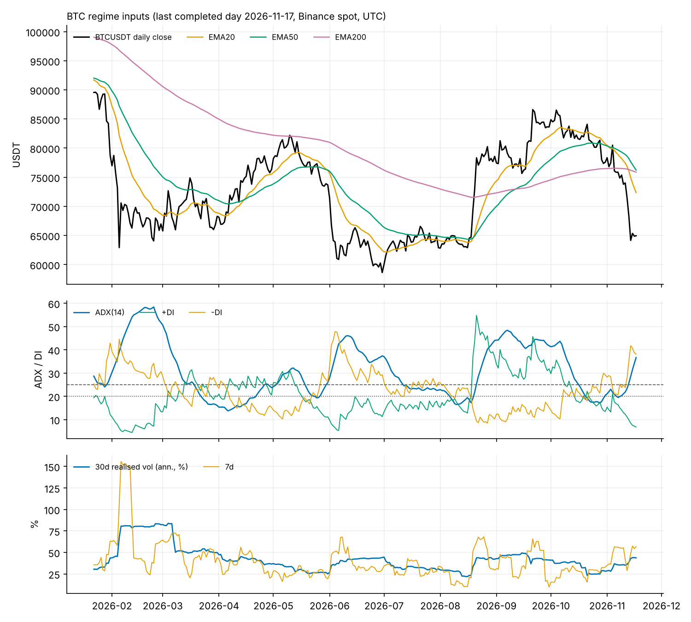

# STAGE 04 — Market regime assessment (as of 2026-11-18 15:38 UTC, 20261118T153823Z)

Inputs: `STAGE_03_HANDOFF.json` (eligibility, budgets, T1–T10), `STAGE_02_HANDOFF.json`, `STAGE_01_HANDOFF.v2.json` (universe, regime hypotheses). Code commit `b9641514b324` (stage02–04 source dirty at run: False). Research only: no orders, no credentials, public GET endpoints only. The 2025-11-17..2026-11-17 window stays `CONSUMED_LEGACY`; nothing here is a holdout or a performance claim.

**Labels.** [M] measured now from a timestamped source; [H] historical/descriptive (Stage 02 trades, includes the consumed final year); [D] derived rule/heuristic; [U] unavailable/unverified.

## Headline

**Market regime (BTC-anchored, 9-asset breadth): BEARISH / TRENDING / volatility NORMAL / liquidity AVERAGE / momentum NEGATIVE — label confidence SUPPORTED (9 of 10 price/breadth/macro signals bearish, 1 bullish, 0 neutral).**

1. **A broad, accelerating downtrend.** All 9 assets are Bearish (BTC and LINK 4/5 votes, the other seven 5/5; BTC's EMA50 is still above EMA200, its one bullish vote). BTC 64,947 is -14.4% vs EMA200, -23.5% over 30d; ADX 36.7 and rising (+13.3 in 5d). [M]
2. **All three tested strategies are gated off by their own rules.** MOM needs close>SMA300(4H), BTC>SMA300 and M≥1.25 (BTC M=-2.00; BTC must rise +23.1% to reach its 4H SMA300); REV's trend filter fails everywhere; VEX's 4H>SMA50 context fails on all 9. Zero signals in the last 7 days on any asset. [M] The classification therefore supports **no new entries** in the current regime — the research-consistent action is to stay flat/paper-only, not to find a better-fitting rule.
3. **Contrarian/valuation indicators disagree with the trend and are not enough to relabel.** Fear & Greed 11 (Extreme Fear), MVRV 1.21 (provisional, 78-day window only) and 7-day exchange outflow -0.88B are washed-out readings. They raise the odds of a regime change but are not part of the preselected direction rule, and none is a validated reversal signal. [D]
4. **Volatility is only 'Normal' (RV30 at percentile 41) despite a -23.5% month** — an orderly grind rather than a spike; but RV7 (percentile 71) is above RV30 and the S&P 500 is -5.1% from its high with VIX 25.5. Risk-off macro agrees with crypto. [M]
5. **Concentration is near the Stage 03 limit:** 30-day mean pairwise correlation 0.879 vs the 0.90 T9 threshold (definition may differ). [M]
6. **Liquidity is mixed:** LINK and DOGE Weak by the volume rule; ADA, LINK, AVAX, LTC fail the Stage-01 L1 gate ($20M median daily); BTC is Strong by the completed day (1.58×, the sell-off day) but Average on a rolling-24h basis (1.08×). [M]

## A. Timestamped regime assessment

Snapshot fetched 2026-11-18 15:38:23+00:00 UTC. Indicators use **completed UTC days** (last completed day 2026-11-17); signal-gate state uses the last completed 4H/1H bar (Binance spot, last 1H bar open 2026-11-18 14:00:00+00:00 UTC). The Binance spot archive used by Stage 02 and the live API agree exactly on 192 overlapping BTC hours (max relative close difference 0.0e+00).

| Asset | Direction | Votes +/- | EMA stack | ADX | Structure | ATR% | RV30 pctile | Volatility | Momentum | 30d ret | Vol ratio day/24h | Liquidity | 30d vs BTC |
| --- | --- | --- | --- | --- | --- | --- | --- | --- | --- | --- | --- | --- | --- |
| BTC | Bearish | 1/4 | mixed | 37 | Trending | 4.0% | 41 | Normal | Negative | -23.5% | 1.58/1.08 | Average* | — |
| ETH | Bearish | 0/5 | 20<50<200 | 36 | Trending | 5.8% | 40 | Normal | Negative | -27.8% | 1.32/1.14 | Average* | -4.4% |
| SOL | Bearish | 0/5 | 20<50<200 | 47 | Trending | 6.3% | 19 | Low | Negative | -32.5% | 1.31/0.99 | Average* | -9.1% |
| XRP | Bearish | 0/5 | 20<50<200 | 37 | Trending | 6.0% | 47 | Normal | Negative | -28.4% | 0.87/1.00 | Average | -5.0% |
| ADA | Bearish | 0/5 | 20<50<200 | 42 | Trending | 7.4% | 38 | Normal | Negative | -35.3% | 1.07/1.05 | Average | -11.9% |
| LINK | Bearish | 1/4 | mixed | 36 | Trending | 7.1% | 40 | Normal | Negative | -25.5% | 0.66/0.58 | Weak | -2.1% |
| AVAX | Bearish | 0/5 | 20<50<200 | 23 | Transitioning | 7.9% | 39 | Normal | Mixed | -29.2% | 0.90/0.66 | Average* | -5.8% |
| DOGE | Bearish | 0/5 | 20<50<200 | 46 | Trending | 6.4% | 23 | Low | Negative | -27.8% | 0.69/0.58 | Weak | -4.4% |
| LTC | Bearish | 0/5 | 20<50<200 | 43 | Trending | 6.1% | 46 | Normal | Negative | -26.4% | 0.78/0.92 | Average | -3.0% |

\* completed-day and rolling-24h volume rules disagree → reported Average. Direction votes: close>EMA200, EMA50>EMA200, EMA20>EMA50, +DI>-DI, 30d return>0.

**Market level:** Direction **Bearish** (BTC Bearish, 9/9 assets Bearish ≥ 60%); Volatility **Normal** (BTC; SOL/DOGE Low; none Elevated); Liquidity **Average** with a documented conflict (see table); Momentum **Negative** (8/9 Negative, AVAX Mixed); Structure **Trending** (8/9; AVAX Transitioning). Confidence **SUPPORTED** on direction; **CONDITIONAL** on volatility and liquidity labels, whose thresholds need calibration.

**What would make this UNCERTAIN instead (checked, none triggered):** stale data (max bar age 0.65h), venue disagreement (max Binance–Coinbase gap 18.0bp, a stable USDT/USD basis of ~10–18bp, hourly deviation ≈1bp), or a breadth split. Two inputs are stale relative to now and are context only: S&P 500 (2026-11-16) and the broad USD index (2026-11-13).

### Cross-venue and liquidity detail

| Asset | Binance last close | Binance vs Coinbase (bp) | basis σ-ish (bp) | bar age (h) | Binance spread (bp) | Binance depth ±10bp (k USD, thinner side) | Coinbase spread (bp) | Coinbase depth ±10bp (k USD) | 24h quote vol (M USDT) |
| --- | --- | --- | --- | --- | --- | --- | --- | --- | --- |
| BTC | 6.368e+04 | +11.4 | 0.9 | 0.64 | 0.00 | 994† | 0.00 | 1,320 | 1,251 |
| ETH | 1,776 | +11.3 | 1.3 | 0.64 | 0.06 | 1,299† | 1.36 | 609 | 569 |
| SOL | 74.15 | +12.2 | 1.8 | 0.64 | 1.35 | 643 | 1.36 | 179 | 179 |
| XRP | 0.9862 | +10.2 | 1.1 | 0.64 | 1.02 | 452 | 2.04 | 236 | 109 |
| ADA | 0.1527 | +17.1 | 3.3 | 0.64 | 6.58 | 57 | 3.29 | 20 | 16 |
| LINK | 9.104 | +12.1 | 3.1 | 0.64 | 1.10 | 44 | 1.10 | 27 | 11 |
| AVAX | 7.055 | +2.8 | 3.9 | 0.64 | 1.42 | 29 | 1.43 | 22 | 11 |
| DOGE | 0.05927 | +15.2 | 3.3 | 0.64 | 1.70 | 170 | 3.40 | 28 | 20 |
| LTC | 44.08 | +18.0 | 2.6 | 0.65 | 2.28 | 25 | 2.28 | 16 | 13 |

† Binance snapshot has 100 levels per side; where the book does not span ±10bp, depth is understated. Depth and spread are reported, **not used** in labels (no calibration). Single snapshot only; no depth history exists.

### Derivatives (perpetual funding, open interest, liquidations)

| Asset | HL funding (ann.) | OKX funding (ann.) | HL OI (M USD) | OKX OI (M USD) | OKX OI 7d | OKX liquidations last window: long / short (k USD) |
| --- | --- | --- | --- | --- | --- | --- |
| BTC | +11.0% | +5.7% | 2,596 | 2,170 | -23.6% | 316 / 520 (44 min) |
| ETH | +8.7% | -4.0% | 1,071 | 1,232 | -14.8% | 172 / 634 (40 min) |
| SOL | +4.1% | +4.2% | 320 | 232 | — | — |
| XRP | +1.4% | +1.1% | 75 | 77 | — | — |
| ADA | +11.0% | -2.6% | 21 | 17 | — | — |
| LINK | +4.8% | +0.1% | 29 | 17 | — | — |
| AVAX | +11.0% | -5.6% | 16 | 10 | — | — |
| DOGE | +7.6% | +7.1% | 29 | 62 | — | — |
| LTC | +8.4% | +8.6% | 15 | 20 | — | — |

Funding is mildly positive on BTC (Hyperliquid at its 12th 31-day percentile; OKX at the 34th percentile of the last ~33 days), slightly negative on OKX ETH (-4.0%). **Not crowded.** OKX BTC open interest fell -23.6% in 7 days and ETH -14.8%: de-leveraging, not a build-up. The OKX liquidation endpoint returns only the latest ~100 filled events (≈44 min), valued with an **assumed** contract size (BTC 0.01, ETH 0.1): no cascade is visible in that window, but a 40-minute window says nothing about the past week. Binance and Bybit derivatives data are blocked from this container (HTTP 451/403) [U].

### Macro and on-chain

- **S&P 500** 7,417 (2026-11-16): -3.6% over 20 obs, -5.1% from 252-obs high. **VIX** 25.46 (2026-11-17; 94th 1y percentile; +8.2 in 20 obs). **US 10y** 5.12% (2026-11-16; 92th pctile). **Broad USD** 122.7 (2026-11-13; at its 252-obs high). Source: FRED public CSV. [M]
- **BTC–S&P 500 correlation:** 0.66 on 30 paired days (asynchronous closes; a coincident-risk indicator, not a tested predictor). [M]
- **Scheduled events** (secondary calendars; **not verified against federalreserve.gov/bls.gov**): FOMC Dec 8–9 (decision Dec 9 14:00 ET); jobs report Dec 4; CPI Dec 10 (one calendar lists Dec 4 → conflict, unverified against BLS); US Thanksgiving Nov 26 (derived from the calendar: thin US-session liquidity); monthly crypto-derivatives expiry Nov 27 (derived: last Friday; venue not verified). Nothing scheduled inside the next 7 days other than the derived holiday/expiry effects. October CPI was due Nov 10; its outcome and market surprise were **not retrieved** [U].
- **Sentiment:** Fear & Greed 11 (Extreme Fear, 2026-11-18); 30-day mean 35; 10% of the last 60 days ≤20. BTC dominance 58.2%, total market cap -4.4% in 24h (CoinGecko). [M]
- **On-chain (limited):** Coinmetrics community MVRV 1.21 for 2026-11-17 (single provider; flow fields flagged 'flash'/provisional; **no second source**), exchange netflow 7d -0.88B USD. Hashrate cross-check: blockchain.info 1,052 EH/s vs mempool.space 987 EH/s (agree within ~7%; mempool +4.9% over 90d, next difficulty adjustment +11.2% est.) — network health is not stressed. MVRV, SOPR, realised-cap ratios, ETF flows and stablecoin supply were **not independently verified**. [U]

## B. Indicator and threshold table

| Dimension / indicator | Rule (thresholds) | Current reading (BTC) | Label | Threshold status |
| --- | --- | --- | --- | --- |
| Direction | ≥4 of 5 votes (close>EMA200, EMA50>EMA200, EMA20>EMA50, +DI>-DI, 30d ret>0) → Bullish; ≤-4 → Bearish; ADX<20 and |30d ret|<5% → Sideways; else Uncertain | votes bull/bear 1/4 | Bearish | vote rule + 5% REQUIRE CALIBRATION |
| EMA 20/50/200 (daily, span, adjust=False) | reported | 72,358 / 76,232 / 75,869 | mixed | PRESELECTED (task-mandated) |
| ADX(14) daily (Wilder smoothing) | ≥25 Trending; <20 and ER30<0.30 Mean-reverting; else Transitioning | ADX 36.7 (5d chg +13.3), ER30 0.46 | Trending | 25/20 PRESELECTED; ER cut REQUIRES CALIBRATION |
| ATR(14)/price (daily) | reported; percentile vs own history | 4.03% (56th pctile) | — | descriptive |
| Realised vol 30d (ann.) pctile vs own history since 2021-05 | <25 Low; 25–75 Normal; 75–95 Elevated; ≥95 Extreme | 43.7% (41th pctile); 7d 56.7% (71th) | Normal | cuts PRESELECTED; need calibration; history includes consumed windows |
| Volume vs rolling baseline | last completed-day quote vol ÷ prior-30d median daily: ≥1.25 Strong; <0.75 Weak; else Average (rolling 24h also computed; disagreement → Average) | 1.58× completed day; 1.08× rolling 24h | Average | REQUIRES CALIBRATION |
| Momentum | Positive if 7/30/90d log returns all >0; Negative if all <0; else Mixed | -12.8% / -23.5% / -6.5% | Negative | PRESELECTED; not calibrated |
| Relative strength | log-return difference vs BTC (alts) / vs equal-weight alt basket (BTC) | BTC vs alt basket 30d +5.7%; every alt below BTC at 30d | — | descriptive; benchmark choice (BTC) is a research choice |
| Market-level label | BTC label, accepted only if ≥60% of 9 assets share it; else Uncertain | 9/9 Bearish, 0/9 Bullish | Bearish | 0.60 REQUIRES CALIBRATION |
| Label confidence | share of directional price+macro signals agreeing ≥0.8 SUPPORTED; 0.6–0.8 CONDITIONAL; <0.6 UNCERTAIN | 9/10 bearish, 1 bullish, 0 neutral → 0.90 | SUPPORTED | REQUIRES CALIBRATION |
| Funding crowding | |annualised funding| >30% | HL BTC +11.0%, OKX BTC +5.7%, OKX ETH -4.0% | not crowded | REQUIRES CALIBRATION |
| Staleness / cross-venue | >2h bar age or >30bp Binance–Coinbase gap blocks a confident label | max bar age 0.65h; max basis 18.0bp | pass | PRESELECTED |

**Preselected vs requires calibration.** All thresholds were fixed in `stage04/regime.py` before the current values were computed and are conventional, not fitted. The rules marked REQUIRES CALIBRATION have never been tested for stability, sensitivity or predictive value; the Stage 02 trade split below is purely descriptive and was not used to set any cut. Percentile-based volatility labels depend on a 1996-day history starting 2021-05-31 (which contains the 2022 bear market and the consumed final year). Cut levels for BTC RV30: 25th 37%, 50th 47%, 75th 62%, 95th 83%. In this history ADX≥25 on 55% of days, so "Trending" is not rare for BTC under this definition.

## C. Signal agreement / disagreement (BTC-anchored)

| Group | Signal | Stance | Reading |
| --- | --- | --- | --- |
| Price | Close vs EMA200 | bear | close 64,947 vs EMA200 75,869 (-14.4%) |
| Price | EMA20 vs EMA50 | bear | 72,358 vs 76,232 |
| Price | EMA50 vs EMA200 | bull | 76,232 vs 75,869 (BTC only; every other asset has 20<50<200) |
| Price | +DI vs -DI (daily) | bear | +DI 6.8 / -DI 38.1 |
| Price | 30d return | bear | -23.5% (log) |
| Price | 90d return | bear | -6.5% (log) |
| Breadth | Assets above own EMA200 | bear | 0 of 9 |
| Macro | S&P 500 vs 50-obs mean | bear | 7,417 (2026-11-16); -5.1% from 252d high |
| Macro | VIX level (>25 risk-off, preselected) | bear | 25.5 (2026-11-17), 1y pctile 94 |
| Macro | Broad USD index vs 50-obs mean | bear | 122.7 (2026-11-13, STALE >2d), 1y pctile 100 |
| Valuation | MVRV (Coinmetrics community, provisional) | bull | 1.21; lowest 3th pctile of only 78 days |
| Sentiment | Fear & Greed | bull | 11 (Extreme Fear); 60d range 10-78 |
| Flows | Exchange net flow 7d (Coinmetrics, flash) | bull | -0.88B USD (negative = net outflow) |

- **Agree (trend + breadth + macro):** 9 of 10 bearish; the only bullish trend vote is BTC's EMA50>EMA200 (a lagging 200-day-scale relationship).
- **Disagree (contrarian/valuation):** 3 of 3 valuation/sentiment/flow signals are washed-out/bullish-contrarian. Treated as **regime-change risk**, not as direction, because the direction rule is trend-based and the contrarian readings are provisional, short-window, or have no tested lead time.
- **Internal tension (not a conflict in direction):** high ADX + falling OI + extreme fear is what a late-stage trend looks like, but this repository has **no tested exhaustion rule**, so the label stays Bearish/Trending [D].
- **Volume paradox:** volume on the last completed day was 1.58× its baseline (Strong) while the rolling 24h is 1.08× (Average): sell-off participation faded. Reported as Average.

## D. Strategy-to-regime suitability matrix

| Strategy (Stage 03 eligibility) | Stage-01 regime hypothesis | Current regime vs hypothesis | Suitability now [M] | Implication |
| --- | --- | --- | --- | --- |
| CRY-MOM-101 | persistent directional; unsuited to chop/V-reversals | Bearish/Trending/Negative = directional but in the opposite direction to a long-only rule | **NOT SUPPORTED — gate closed** (0 of 9 assets pass; BTC filter false; M -2.00 vs 1.25) | Stand aside; paper-monitor; Stage 03 budget unchanged but unused |
| CRY-REV-102 | uptrend dips, wide range, ample liquidity; unsuited to cascade/contagion crashes and structural breaks | downtrend, 0/9 above SMA300; rsi3 29-56 (≤8 required) | **NOT SUPPORTED — gate closed; stage-03 status REJECT/shadow** | Shadow log only (no change) |
| CRY-VEX-103 | quiet-to-active vol transition in liquid sessions; unsuited to thin/weekend liquidity | Normal-vol, volume surging (2.4× 168h median on BTC) but 4H close < SMA50 on all 9 → ctx filter false | **NOT SUPPORTED NOW — gate closed; conditional on 4H SMA50 reclaim** | Shadow/paper only (Stage 03); would arm first as ctx flips |

Per-asset gate failures, last completed bar (MOM): BTC: c<SMA300, SMA300 not rising, BTC filter, M<1.25; ETH: c<SMA300, SMA300 not rising, BTC filter, M<1.25; SOL: c<SMA300, SMA300 not rising, BTC filter, M<1.25; XRP: c<SMA300, SMA300 not rising, BTC filter, M<1.25; ADA: c<SMA300, SMA300 not rising, BTC filter, M<1.25, L-gate; LINK: c<SMA300, SMA300 not rising, BTC filter, M<1.25, L-gate; AVAX: c<SMA300, SMA300 not rising, BTC filter, M<1.25, L-gate; DOGE: c<SMA300, SMA300 not rising, BTC filter, M<1.25; LTC: c<SMA300, SMA300 not rising, BTC filter, M<1.25, L-gate.

Assets passing Stage-01 L1–L3 gates now: BTC, ETH, SOL, XRP, DOGE. ADA, LINK, AVAX, LTC fail ≥1 gate.

**[H] Descriptive history for the current BTC tag (Bearish|Trending), Stage 02 baseline standalone books, assumed costs, includes the consumed final year; no significance testing, no thresholds tuned on it:**

| Strategy | Trades entered under current tag | Trades entered under any Bearish tag | Largest cells (dir|struct, n, mean R) |
| --- | --- | --- | --- |
| CRY-MOM-101 | n=0 (no trades) | 2 trades (mean R -0.15) | Bull|Trend n=91 R+0.36; Bull|Trans n=39 R+0.29; Bull|Mean- n=13 R-0.36; Unce|Trend n=12 R-0.12 |
| CRY-REV-102 | n=0 (no trades) | 2 trades (mean R +0.16) | Bull|Trend n=32 R+0.03; Bull|Trans n=14 R+0.14; Bull|Mean- n=11 R-0.07; Unce|Mean- n=4 R-0.21 |
| CRY-VEX-103 | n=159, mean R +0.09, win 33% | 264 trades (mean R +0.09) | Bull|Trend n=337 R-0.02; Bear|Trend n=159 R+0.09; Bull|Mean- n=152 R+0.10; Bull|Trans n=94 R+0.15 |

The tag was assigned from the prior daily close. Days in this tag over the 5.5-year history: Bearish|Trending 382 of 1828. MOM and REV (long-only with SMA300 filters) almost never trade in Bearish tags by construction, so their history cannot say how they behave in this regime — it can only say the rule keeps them out. VEX did trade in Bearish|Trending (159 trades, mean R +0.09 at assumed costs), but the 4H SMA50 context currently blocks all signals, and a mean R of that size is within the noise Stage 03 documented (VEX cost drag ≈ gross edge). **No regime-conditioned performance claim is made.**

## E. Regime change triggers

| # | Trigger | Current / distance | Note |
| --- | --- | --- | --- |
| R1 MOM prerequisite | BTC 4H close > 4H SMA300 (and the asset's own) | BTC 64,232 vs SMA300 79,038: needs +23.1% (= 5.7 daily ATRs) | re-enables MOM gate only; M≥1.25 also needed (BTC M=-2.00) |
| R2 Direction flip (BTC) | daily close > EMA20 / EMA50 / EMA200 (≥2 more votes needed for ≥4/5 Bullish or to drop below 4/5 Bearish) | +11.4% / +17.4% / +16.8% away | Bearish → Uncertain on 2 vote changes; Bullish needs ≥4 |
| R3 Structure | ADX(14) < 25 (Trending→Transitioning); <20 with ER30<0.30 (→Mean-reverting) | ADX 36.7, rising +13.3 in 5d; ER30 0.46 | an ADX peak/roll-over with price still below EMAs is the usual late-trend signal [untested] |
| R4 Volatility | RV30 percentile ≥75 (≥62% ann.) → Elevated; ≥95 (≥83%) → Extreme; <25 (<37%) → Low | RV30 43.7%, RV7 56.7% (71th pctile) | RV7 is already above RV30: short-horizon vol is rising |
| R5 Liquidity | rolling-24h volume ÷ 30d median <0.75 (Weak) or >1.25 (Strong); L1–L3 gate failures | BTC 1.08×; gate failures now: ADA, LINK, AVAX, LTC | Stage 03 T8 also applies |
| R6 Breadth/concentration | share of assets Bullish ≥60% (breadth); 30d mean pairwise correlation >0.90 (Stage 03 T9) | 0/9 Bullish; corr 0.879 (own daily-return definition; may differ from Stage 03's cohort measure) | correlation is close to the T9 limit |
| R7 Derivatives | |funding| >30% annualised; OKX OI 7d change beyond ±20%; liquidation burst (no history here) | funding +11.0%/+5.7%; OKX BTC OI 7d -23.6% | deleveraging already in progress (OI falling) |
| R8 Macro/sentiment | VIX >30 or <18; S&P 500 reclaiming its 50-obs mean; Fear&Greed >25 sustained | VIX 25.5; SPX -5.1% from high; F&G 11 | events: FOMC Dec 8–9 (decision Dec 9 14:00 ET); jobs report Dec 4; CPI Dec 10 (one calendar lists Dec 4 → conflict, unverified against BLS); US Thanksgiving Nov 26 (derived from the calendar: thin US-session liquidity); monthly crypto-derivatives expiry Nov 27 (derived: last Friday; venue not verified) |
| R9 Data/venue | bar age >2h; Binance–Coinbase gap >30bp; any venue/API outage; archive vs API mismatch | age 0.65h; gap 18.0bp; overlap diff 0.0e+00 | label becomes UNCERTAIN on any breach |

Handling rule: any of R9, or two or more of R1–R8 flipping in the same 24h, moves the label to **UNCERTAIN** until re-measured on completed bars. Re-run `PYTHONPATH=. scripts/lab python -m stage04.fetch_live` then `-m stage04.regime`. All trigger levels are measurements of distance, not forecasts; no probability of a regime change is asserted.

## F. STAGE_04_HANDOFF

See `STAGE_04_HANDOFF.json`. Key content: classification {Direction Bearish, Volatility Normal, Liquidity Average (conflict), Momentum Negative, Structure Trending}, confidence SUPPORTED; strategy suitability NOT SUPPORTED NOW for all three (gates closed); eligibility unchanged from Stage 03 but with no admissible entries; evidence SHA-256 for every fetched file; limitations and unresolved items below.

## Limitations and missing inputs

- Venue is still unspecified (Stage 01). Binance spot (public mirror) is the primary price source; Coinbase and Kraken are cross-checks. Binance/Bybit perpetuals blocked; funding/OI come from Hyperliquid and OKX, which are different venues and populations.
- No options/implied-vol, spot-ETF flow, stablecoin-supply, SOPR/realised-cap or cohort-position data; liquidation history unavailable beyond ~40 minutes; macro event outcomes not retrieved; FRED combined request timed out (single-series requests used); S&P 500 and USD series 2–5 days stale.
- Percentile/threshold cuts are uncalibrated; the 5.5-year reference window contains one full cycle and the consumed final year. A single snapshot cannot show stability of the label across time.
- Contract sizes for OKX liquidation USD values are assumed. Order-book snapshots are single, 100-level and venue-specific.
- Historical regime-conditioned trade statistics are small-sample, descriptive, cost-assumed and include `CONSUMED_LEGACY` data. They are not evidence for or against any strategy.

## Sources (public, read-only)

Binance spot via data-api.binance.vision (klines, 24h ticker, depth); Coinbase Exchange API (candles, book); Kraken public Ticker; Hyperliquid info API (metaAndAssetCtxs, fundingHistory); OKX public API (funding, open interest, rubik OI, liquidation orders); alternative.me Fear & Greed; CoinGecko global; Coinmetrics community API; blockchain.info stats; mempool.space; FRED CSV (SP500, VIXCLS, DGS10, DTWEXBGS). Calendar: [Federal Reserve December 2026 page](https://www.federalreserve.gov/newsevents/2026-december.htm), [FOMC Dec 2026 (calendarx)](https://www.calendarx.com/events/fomc-meeting-december-2026), [Dec 2026 release schedule (fedratecalc)](https://fedratecalc.com/us-economic-calendar/december-2026/) — dates from search snippets, not verified at the primary source. Raw responses and SHA-256 manifest: ignored `data/s4raw/20261118T153823Z/`; hashes embedded in the handoff.
