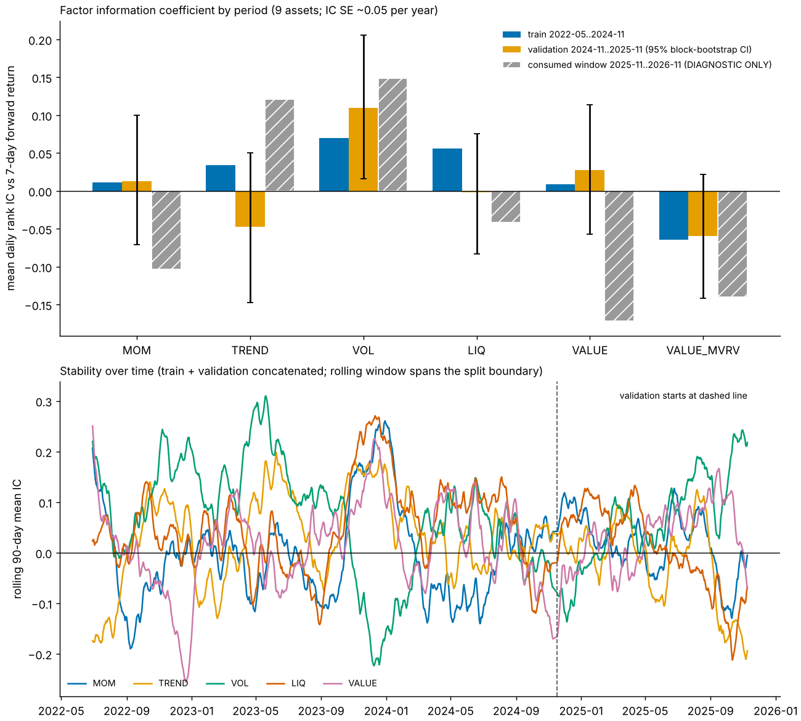

# Stage 05 — Regime-aware multi-factor signal model (CRY-MFS-201, v0.1.0-draft)

**Status:** `RESEARCH_SPEC_NOT_VALIDATED` · research only (no orders, credentials or execution) · prepared 2026-11-18 · code `1104cf45d4` (dirty at run: False) · frozen-model sha256 `0c6ebcd7dc7f1040…`
**Inputs:** Stage 01–04 handoffs (`STAGE_01_HANDOFF.v2.json` … `STAGE_04_HANDOFF.json`). **Ledger:** `hyp-cry-mfs-201@1` REGISTERED before any factor statistic was computed; preregistration NOT frozen; `adjudicate.py` NOT run.

## Headline

- **The model is fully specified, reproducible and frozen, but it has NOT demonstrated predictive skill.** Everything below is a development-stage assessment on train and validation windows that were already known to the project (Stage 02: "not untouched"). The consumed 2025-11-17 → 2026-11-17 window is `CONSUMED_LEGACY`; it was read only after the model was frozen and only descriptively.
- **Frozen composite** = equal weights on **MOM, VOL, VALUE(price-based proxy)**; TREND, LIQ and the on-chain MVRV value factor have weight 0 (excluded or experimental). Weights are hypotheses to be tested forward, not estimates of anything real.
- **Only VOL clears the pre-declared validation rule** (validation IC +0.110 [+0.016, +0.206]). But a *static* ranking by train-period volatility (BTC, ETH, XRP, LTC … ADA, LINK, DOGE, AVAX, SOL) scores a *higher* validation IC (+0.165) than the dynamic factor (+0.110). The "volatility factor" is therefore a persistent **large-cap-versus-alt tilt in a survivor-selected 9-asset cohort**, not evidence of dynamic volatility timing.
- **The validation result of the frozen composite (+0.114) is optimistic**: the composition was edited after seeing validation (TREND and LIQ dropped). Treat it as a development number. In the consumed window (descriptive only) the frozen composite's IC was -0.116 and net top-3 excess -49.9 bp/week; VOL stayed positive (+0.149) while MOM (-0.104) and VALUE (-0.172) were negative. **No change was made to the frozen model after seeing this.**
- **Complexity is not justified yet.** Among the six multi-factor candidates, EQ, NNLS, COND and EQ_TRAINPOS were statistically indistinguishable in validation, so the pre-declared parsimony rule chose fixed equal weights. Separately, the single factor VOL (validation IC +0.110) and a static low-vol tilt (+0.165) score at least as high as any composite, so there is no evidence that combining factors adds anything.
- **Current state (as of 2026-11-17 close):** Stage 04 tag BTC = **Bearish**, Trending; all Stage 02/03 strategy gates are closed, so this model supplies at most a *ranking* and creates no exposure. Evidence for the frozen model in Bearish tags is thin and mixed (see regime stability).

Labels: **[M]** measured here · **[H]** historical/descriptive · **[D]** derived/heuristic · **[U]** unavailable. Every IC below is a cross-sectional Spearman rank IC across **9 assets** (sd of the daily IC ≈ 0.35), so statistical power is low: one validation year has ≈51 effective weeks, SE of a mean IC ≈ 0.049, and the minimum detectable mean IC (one-sided 5 %, 80 % power) ≈ 0.12.

## 1. Data, splits and protocol

| Window | Signal dates | Role |
|---|---|---|
| Train | 2022-05-01 → 2024-11-09 (924 days) | fit weights/signs check; full-factor start 2022-05-01 because VALUE needs 365 days of history |
| Validation | 2024-11-17 → 2025-11-09 (358 days) | compare/select candidates (not untouched) |
| Consumed legacy | 2025-11-17 → 2026-11-10 (359 days) | `CONSUMED_LEGACY` — frozen model only, after freeze, descriptive |

- **Target** y = ln(C[t+7] / O[t+1]): signal at the close of day *t*, entry at the next open, 7-day horizon. Targets never cross a split boundary (last train signal 2024-11-09, last validation signal 2025-11-09). Horizons 1 and 30 days are reported as descriptive context only.
- **Data:** Binance spot USDT daily bars built from the Stage 02 hourly archive plus fresh klines (snapshot `20261118T153823Z`; archive/fresh overlap matched exactly in Stage 04). A day is valid only with all 24 hourly bars; 4 days are missing for all nine assets. Coinmetrics community MVRV (8/9 assets) fetched per asset, hashes in the handoff. Survivor-selected cohort, single venue family, assumed (not observed) costs.
- **Pre-declared rules** (in `stage05/evaluate.py` docstring, written before any statistic): sign of each factor fixed a priori and never flipped by data; factor status SUPPORTED / EXPERIMENTAL_WEAK / EXCLUDED by the train+validation rule; weights fitted on train only; candidate chosen on validation as the lowest-complexity candidate not distinguishable from the best by a paired block bootstrap.
- **Inference:** circular block bootstrap, 14-day blocks, 10 000 reps, seed 20261118 (block-length sensitivity in §8). **Multiplicity:** 169 statistical evaluations were executed in `run_stage05.py` (including diagnostics); no correction is applied and none of the confidence intervals should be read as multiplicity-adjusted.

## A. Factor definitions and formulas

### MOM — Momentum  ·  status **EXPERIMENTAL_WEAK**
- **Formula:** `x = ln(C_t / C_{t-30})`  ·  **Inputs:** daily close C (UTC day; valid only if all 24 hourly bars exist)  ·  **Lookback:** 30 days (needs C_{t-30})
- **Direction / normalisation:** hypothesised sign +1; cross-sectional rank-normal z (Phi^-1((rank-0.5)/N)), clipped +-2, oriented so higher z = hypothesised higher future return
- **Availability timing:** known at 00:00 UTC after day t closes; traded at O_{t+1}; no later data used
- **Missing values:** NaN if C_t or C_{t-30} missing (4 archive-gap days for all assets); no fill/impute; asset dropped from that day's cross-section
- **Economic rationale:** slow information diffusion, herding and trend-following capital (Stage 01 CRY-MOM-101 mechanism, but cross-sectional)
- **Expected relationship to future returns:** positive IC at 1-4 week horizons (hypothesis; Stage 02 evidence for the time-series MOM strategy was INVESTIGATE, not confirmed)
- **Potential overlap:** LIQ (volume rises with large moves), TREND (shared price path); informationally the same price path as the Stage 01 MOM strategy
- **[M] Evidence (h=7):** train IC +0.011 [-0.043, +0.068], hit-rate 0.51; validation IC +0.013 [-0.071, +0.100], hit-rate 0.49; mean IC at h=1 / h=30 (train, val): +0.003/-0.005, +0.006/-0.009

### TREND — Trend  ·  status **EXCLUDED**
- **Formula:** `x = ln(EMA50_t / EMA200_t), EMA(span n, adjust=False) on daily close`  ·  **Inputs:** daily close C  ·  **Lookback:** 200 days minimum (min_periods=200) plus EMA memory
- **Direction / normalisation:** hypothesised sign +1; same rank-normal z
- **Availability timing:** same as MOM
- **Missing values:** NaN until 200 valid closes; gaps are skipped by the EMA recursion (no fill)
- **Economic rationale:** persistent drift in assets with established uptrends; slow-moving institutional and discretionary allocation
- **Expected relationship to future returns:** positive IC (hypothesis); very slow factor so few independent observations
- **Potential overlap:** MOM (shared path), VALUE (negatively: long-horizon winners are 'expensive')
- **[M] Evidence (h=7):** train IC +0.034 [-0.026, +0.094], hit-rate 0.51; validation IC -0.047 [-0.147, +0.051], hit-rate 0.41; mean IC at h=1 / h=30 (train, val): +0.034/+0.029, -0.003/-0.072

### VOL — Volatility (low-risk)  ·  status **SUPPORTED**
- **Formula:** `x = sd(ln(C_s/C_{s-1}), s=t-29..t) * sqrt(365); z oriented with sign -1`  ·  **Inputs:** daily close C  ·  **Lookback:** 30 days (>= 27 valid returns)
- **Direction / normalisation:** hypothesised sign -1; rank-normal z of -x
- **Availability timing:** same as MOM
- **Missing values:** NaN if fewer than 27 valid daily returns
- **Economic rationale:** low-risk anomaly: leverage constraints and lottery preference push demand to high-vol assets; in this cohort it also separates large liquid assets from small ones
- **Expected relationship to future returns:** negative raw vol -> higher return (hypothesis; sign uncertain in crypto)
- **Potential overlap:** LIQ (negative), MOM (negative); strongly confounded with asset identity/size in a 9-asset survivor cohort
- **[M] Evidence (h=7):** train IC +0.069 [+0.009, +0.129], hit-rate 0.56; validation IC +0.110 [+0.016, +0.206], hit-rate 0.59; mean IC at h=1 / h=30 (train, val): +0.052/+0.096, +0.049/+0.184

### LIQ — Abnormal liquidity/volume  ·  status **EXCLUDED**
- **Formula:** `x = ln( mean(Q_{t-6..t}) / median(Q_{t-96..t-7}) ), Q = daily quote volume (USDT)`  ·  **Inputs:** daily quote volume Q  ·  **Lookback:** 7-day numerator; 90-day baseline lagged by 7 days (>= 81 obs)
- **Direction / normalisation:** hypothesised sign +1; rank-normal z
- **Availability timing:** same as MOM
- **Missing values:** NaN if the 7-day window or <81 baseline obs missing
- **Economic rationale:** high-volume return premium / attention and participation continuation (alternative hypothesis: attention-driven overshoot, i.e. negative)
- **Expected relationship to future returns:** positive IC (hypothesis, sign chosen a priori; the opposite sign is NOT adopted from data)
- **Potential overlap:** MOM (corr ~0.48); level of volume is a separate execution/eligibility gate (Stage 01 L1-L3), not scored
- **[M] Evidence (h=7):** train IC +0.056 [-0.004, +0.116], hit-rate 0.54; validation IC -0.002 [-0.083, +0.076], hit-rate 0.48; mean IC at h=1 / h=30 (train, val): +0.015/+0.040, -0.016/-0.028

### VALUE — Value proxy (price-based long-horizon reversal; NOT fundamental value)  ·  status **EXPERIMENTAL_WEAK**
- **Formula:** `x = ln(C_{t-90} / C_{t-365}); z oriented with sign -1`  ·  **Inputs:** daily close C  ·  **Lookback:** 365 days (skips the latest 90)
- **Direction / normalisation:** hypothesised sign -1; rank-normal z of -x
- **Availability timing:** same as MOM
- **Missing values:** NaN until 365 days of history (train sample therefore starts 2022-05-01)
- **Economic rationale:** long-horizon reversal analogue (De Bondt-Thaler); a price statistic standing in for 'cheapness'. No cash-flow, token-economics or fundamental data are used; it must not be described as measured value
- **Expected relationship to future returns:** positive after sign flip (hypothesis; weak)
- **Potential overlap:** TREND (corr ~-0.39: long-run losers have weak trends)
- **[M] Evidence (h=7):** train IC +0.009 [-0.055, +0.075], hit-rate 0.51; validation IC +0.028 [-0.057, +0.114], hit-rate 0.49; mean IC at h=1 / h=30 (train, val): -0.017/+0.032, +0.005/+0.060

### VALUE_MVRV — On-chain value (EXPERIMENTAL)  ·  status **EXCLUDED**  (experimental, never in the composite)
- **Formula:** `x = ln(MVRV_{t-1}), MVRV = market cap / realised cap (Coinmetrics community CapMVRVCur); z oriented with sign -1`  ·  **Inputs:** Coinmetrics community daily CapMVRVCur (8 of 9 assets; SOL absent; AVAX via avaxc)  ·  **Lookback:** 1 day (lagged)
- **Direction / normalisation:** hypothesised sign -1; rank-normal z of -x over available assets (>=5)
- **Availability timing:** value stamped D is used no earlier than day D+1 (extra lag; revisions/vintages unavailable)
- **Missing values:** SOL missing for all dates; NaN otherwise left missing
- **Economic rationale:** low MVRV = price near aggregate cost basis ('cheap'); BTC-only evidence is regime-level, cross-sectional use across chains with different realised-cap definitions is unvalidated
- **Expected relationship to future returns:** positive after sign flip (hypothesis)
- **Potential overlap:** VALUE and MOM (price enters MVRV directly)
- **[M] Evidence (h=7):** train IC -0.064 [-0.122, -0.005], hit-rate 0.41; validation IC -0.059 [-0.142, +0.022], hit-rate 0.43; mean IC at h=1 / h=30 (train, val): -0.037/-0.071, -0.020/-0.115

**Why VALUE is a proxy.** No fundamental, cash-flow, token-supply or revenue data exist in this project for the nine assets, so relative valuation is **[U] not measured**. VALUE is a *price-only* long-horizon reversal statistic. The only value-like measured input is on-chain MVRV (community tier, 8/9 assets, no point-in-time vintages, realised-cap definitions differ across UTXO, account-based and token chains); its IC had the **opposite** sign to the hypothesis in train (-0.064) and validation (-0.059). The sign was not flipped; the factor is excluded.

Status rule outcome: SUPPORTED = VOL; EXPERIMENTAL_WEAK = MOM, VALUE; EXCLUDED = TREND, LIQ, VALUE_MVRV. *Qualification:* SUPPORTED means only "passed the pre-declared validation rule"; VOL's support is a static cohort tilt (§8).



## B. Normalisation methodology

1. **Raw value** per asset from data ≤ t (formulas in A). **Orientation** by the a-priori sign, so higher z always means "hypothesised higher future return".
2. **Cross-sectional rank-normal transform** at each date t over the assets valid on that date: z = Φ⁻¹((rank − 0.5)/N_t), ties by average rank, clipped to ±2.0. Requires N_t ≥ 5 assets, else the row is NaN. Rank-normal is used because with N ≤ 9 means/variances are unstable and returns are heavy-tailed; it bounds the influence of any one asset and removes market-wide level shifts, so a factor is a *relative* statement.
3. **No time-series normalisation, no look-ahead:** the transform at date t uses only same-date values. [M] **Point-in-time truncation test** — factors recomputed from data truncated at five dates match the full-sample values exactly (max |diff| = 0e+00; passed = True). A deliberately leaked factor is detected by the harness (unit test), and a random-walk panel yields no spurious IC.
4. **Missing values:** never imputed. A factor missing for an asset-day is excluded from that asset's score and the remaining weights are re-normalised, provided at least min(3, #factors in the model) factors are present; otherwise the score is NaN. The frozen model has 3 factors, so all three are required.
5. **Execution latency:** delaying every score by an extra day leaves the frozen validation IC at +0.109 (vs +0.114).

## C. Factor dependence table

**Average cross-sectional rank correlation of z-scores** (upper triangle = train, lower triangle = validation):

|  | MOM | TREND | VOL | LIQ | VALUE |
|---|---|---|---|---|---|
| MOM | 1 | +0.26 | -0.11 | +0.48 | +0.00 |
| TREND | +0.28 | 1 | +0.07 | +0.20 | -0.39 |
| VOL | -0.15 | +0.18 | 1 | -0.20 | -0.04 |
| LIQ | +0.57 | +0.02 | -0.33 | 1 | +0.04 |
| VALUE | +0.08 | -0.20 | -0.25 | +0.24 | 1 |

**Correlation of daily IC series** (train): MOM-TREND +0.21; MOM-LIQ +0.57; TREND-LIQ +0.20; TREND-VALUE -0.33; VOL-LIQ -0.24 (pairs with |ρ| ≥ 0.2 shown).

| Factor | VIF (train) | rank autocorr lag 7 | top-3 retention lag 7 | residual IC train | residual IC val | IC train | IC val |
|---|---|---|---|---|---|---|---|
| MOM | 1.36 | 0.68 | 0.69 | -0.003 | -0.002 | +0.011 | +0.013 |
| TREND | 1.31 | 0.97 | 0.94 | +0.055 | -0.022 | +0.034 | -0.047 |
| VOL | 1.06 | 0.87 | 0.84 | +0.071 | +0.057 | +0.069 | +0.110 |
| LIQ | 1.37 | 0.63 | 0.62 | +0.018 | +0.005 | +0.056 | -0.002 |
| VALUE | 1.20 | 0.94 | 0.91 | +0.012 | +0.036 | +0.009 | +0.028 |

- **Redundancy [M]:** effective number of independent factors (participation ratio of the correlation eigenvalues) = 4.10 (train) / 3.86 (validation) out of 5; condition number 3.4. Largest overlaps: MOM–LIQ (0.48 train, 0.57 validation — the only near-redundant pair), TREND–VALUE (−0.39 train) and VOL–LIQ (−0.33 validation). The *incremental* information in MOM is nil after removing the others (residual IC ≈ 0).
- **Slowness [M]:** TREND, VALUE and VOL are almost static rankings (lag-7 rank autocorrelation 0.87–0.97), so a year of data holds far fewer independent observations than the 358 daily ICs suggest; MOM and LIQ turn over faster (0.63–0.68) and cost more to trade (§D).
- **Incremental information (residual IC):** only VOL keeps a clearly positive residual IC in both train and validation; VALUE's residual is small and positive in both (≈0.01 / 0.04); TREND's residual flips sign (+0.06 train, −0.02 validation); MOM and LIQ have ≈0 residual. [D] The practical dimension of the model is closer to 1–2 factors than 5.

## D. Candidate weight allocations

| Candidate | Fitted params | MOM | TREND | VOL | LIQ | VALUE | Train IC | Validation IC | best − candidate (val, paired) |
|---|---|---|---|---|---|---|---|---|---|
| EQ | 0 | 0.20 | 0.20 | 0.20 | 0.20 | 0.20 | +0.076 [+0.015, +0.136] | +0.041 [-0.050, +0.128] | +0.056 [-0.008, +0.124] |
| PRIOR | 0 | 0.30 | 0.25 | 0.15 | 0.10 | 0.20 | +0.056 [-0.001, +0.115] | +0.024 [-0.067, +0.114] | +0.073 [+0.001, +0.145] |
| EQ_TRAINPOS | 5 | 0.20 | 0.20 | 0.20 | 0.20 | 0.20 | +0.076 [+0.015, +0.136] | +0.041 [-0.050, +0.128] | +0.056 [-0.008, +0.124] |
| ICP | 5 | 0.06 | 0.19 | 0.39 | 0.31 | 0.05 | +0.116 [+0.060, +0.172] | +0.062 [-0.031, +0.153] | +0.034 [+0.008, +0.061] |
| NNLS | 6 | 0.00 | 0.10 | 0.45 | 0.35 | 0.10 | +0.116 [+0.062, +0.170] | +0.096 [+0.018, +0.174] | best |
| COND | 15 | by regime |  |  |  |  | +0.135 [+0.079, +0.191] | +0.065 [-0.034, +0.158] | +0.031 [-0.018, +0.085] |

- **EQ** = 0.2 each. **PRIOR** = initial hypothesis weights (MOM .30, TREND .25, VOL .15, LIQ .10, VALUE .20) — a hypothesis, *not* estimated. **EQ_TRAINPOS** = equal weight on factors with positive train IC (all five here, so identical to EQ). **ICP** = weights ∝ max(0, train mean IC). **NNLS** = non-negative ridge regression of the cross-sectionally rank-normal 7-day target on the five z-scores, λ = 1000 chosen by 5-fold purged blocked CV inside train (CV IC differences across λ are ≤ 0.002 — the choice is immaterial). **COND** = per-regime IC weights (BTC direction tag: Bullish / Bearish / Other) shrunk toward global with k = 250 days; regimes with < 60 train days fall back to global.
- **Train ICs of ICP, NNLS and COND are in-sample** (their weights were fitted on those days) and are shown only for completeness; only the validation column is a comparison.
- **Fitted on train only** (2022-05-01 → 2024-11-09, 924 days ≈ 132 effective weeks). With IC SE ≈ 0.03 per factor in train, differences between the weights ICP/NNLS give each factor are mostly within noise.
- **Regime-conditional weights (train):**

| BTC regime | train days | MOM | TREND | VOL | LIQ | VALUE |
|---|---|---|---|---|---|---|
| Bullish | 425 | 0.07 | 0.15 | 0.35 | 0.25 | 0.19 |
| Bearish | 266 | 0.12 | 0.09 | 0.46 | 0.30 | 0.02 |
| Other | 233 | 0.03 | 0.43 | 0.20 | 0.31 | 0.03 |

### Selection and the frozen model
- Best validation mean IC: **NNLS**. Candidates not distinguishable from it (paired block-bootstrap 95 % CI of the difference contains 0): **EQ, EQ_TRAINPOS, NNLS, COND**. By the parsimony rule the chosen candidate is **EQ** (fewest fitted parameters).
- **Conditional vs fixed weighting [M]:** COND validation IC +0.065 [-0.034, +0.158] vs fixed EQ +0.041 [-0.050, +0.128]; the regime-conditional scheme is not distinguishable from fixed weights and adds ~10 fitted numbers. In validation the Bearish tag covers only 36 days, so conditional weights for the *current* regime cannot be validated from this window.
- **Freeze edit (disclosed):** after selection, factors with status EXCLUDED were set to weight 0 and the rest renormalised: **MOM 0.333, VOL 0.333, VALUE 0.333; TREND 0, LIQ 0, VALUE_MVRV 0**. This edit used validation information, so the frozen validation IC +0.114 [+0.046, +0.185] is **post-selection and optimistic**. MOM and VALUE (EXPERIMENTAL_WEAK) remain in the composite only so the forward test can decide on them (ablation plan, F). Sha256 of the frozen spec: `0c6ebcd7dc7f1040030b232a18760928f54b0deaacaaa98b571a91952a8634fb`.

### Costs and turnover (top-3 long-only, weekly rebalance, 7 phase offsets, 15 bp per side — Stage 01 assumed fee 10 bp + adverse 5 bp, not observed)

| Score | Train net excess vs EW9 (bp/wk) | Train 1-way turnover | Val net excess (bp/wk) | Val 95 % CI | Val 1-way turnover | Val break-even cost (bp/side) |
|---|---|---|---|---|---|---|
| FROZEN (MOM+VOL+VALUE) | +13.4 | 0.27 | +32.1 | [-33.7, +108.8] | 0.23 | 87 |
| EQ | +31.7 | 0.28 | +1.0 | [-68.0, +75.9] | 0.21 | 17 |
| ICP | +30.4 | 0.26 | -8.6 | [-71.6, +51.7] | 0.28 | -1 |
| NNLS | -0.6 | 0.28 | +0.9 | [-60.7, +59.7] | 0.30 | 17 |
| COND | +7.6 | 0.28 | +37.7 | [-39.5, +132.3] | 0.32 | 75 |
| MOM | +32.2 | 0.31 | -7.9 | [-73.6, +67.2] | 0.27 | -0 |
| TREND | +12.1 | 0.07 | -34.7 | [-113.7, +43.9] | 0.06 | -312 |
| VOL | -15.7 | 0.16 | -39.9 | [-148.1, +49.7] | 0.13 | -153 |
| LIQ | +34.9 | 0.38 | +10.8 | [-52.2, +83.3] | 0.35 | 31 |
| VALUE | +0.7 | 0.09 | +14.2 | [-62.0, +102.5] | 0.08 | 118 |
| VALUE_MVRV | -24.8 | 0.06 | -12.9 | [-69.3, +40.6] | 0.09 | -70 |
| STATIC_LOWVOL_ARM | -15.7 | 0.00 | +70.4 | [+9.0, +132.1] | 0.01 | n/a |

- Cost sensitivity of the frozen composite (validation net excess bp/wk): 0bp: +38.9, 15bp: +32.1, 30bp: +25.4, 60bp: +12.0. Turnover is modest (≈0.1–0.4 one-way per weekly rebalance) so costs are not the binding problem; **estimation noise is** — every net-excess confidence interval in the table includes 0 except the static low-vol arm in validation, and that arm's *train* excess is -15.7 bp/wk.
- **IC and the long-only top-3 portfolio disagree [M]:** Among the five primary factors VOL has the best IC in train and validation yet the *lowest* top-3 excess (-15.7 / -39.9 bp/wk). A positive IC can come from ordering the lower and middle ranks (avoiding the worst assets), which a long-only top-3 cannot monetise. Short-selling is disabled in Stage 01. Rank IC is therefore not a proxy for long-only profitability.

### Stability across historical regimes (BTC tags from the Stage 04 rule; point-in-time)

| Score | Train by BTC direction | Validation by BTC direction | Train 1st half / 2nd half |
|---|---|---|---|
| FROZEN | Bearish: +0.044 (n=265) · Bullish: +0.134 (n=420) · Other: -0.042 (n=231) | Bearish: -0.045 (n=36) · Bullish: +0.153 (n=201) · Other: +0.097 (n=121) | +0.070 / +0.057 |
| EQ | Bearish: +0.030 (n=266) · Bullish: +0.129 (n=423) · Other: +0.034 (n=233) | Bearish: -0.078 (n=36) · Bullish: +0.074 (n=201) · Other: +0.021 (n=121) | +0.047 / +0.105 |
| VOL | Bearish: +0.103 (n=266) · Bullish: +0.092 (n=423) · Other: -0.010 (n=233) | Bearish: +0.009 (n=36) · Bullish: +0.148 (n=201) · Other: +0.077 (n=121) | +0.150 / -0.011 |
| MOM | Bearish: +0.034 (n=266) · Bullish: +0.019 (n=422) · Other: -0.030 (n=232) | Bearish: +0.000 (n=36) · Bullish: +0.000 (n=201) · Other: +0.038 (n=121) | -0.016 / +0.038 |
| TREND | Bearish: -0.036 (n=266) · Bullish: +0.036 (n=423) · Other: +0.111 (n=233) | Bearish: -0.114 (n=36) · Bullish: -0.022 (n=201) · Other: -0.068 (n=121) | +0.005 / +0.064 |
| LIQ | Bearish: +0.055 (n=266) · Bullish: +0.059 (n=416) · Other: +0.052 (n=233) | Bearish: +0.039 (n=36) · Bullish: -0.008 (n=201) · Other: -0.003 (n=121) | +0.013 / +0.099 |
| VALUE | Bearish: -0.017 (n=265) · Bullish: +0.075 (n=421) · Other: -0.080 (n=232) | Bearish: -0.176 (n=36) · Bullish: +0.064 (n=201) · Other: +0.028 (n=121) | +0.008 / +0.011 |

- Consumed window (diagnostic, frozen model): Bearish: -0.166 (n=208) · Bullish: +0.006 (n=64) · Other: -0.085 (n=87).
- **Interpretation [D]:** no factor is stable across regimes or halves; VOL's train IC fell from +0.150 (first half) to -0.011 (second half). Frozen-model IC is positive in train Bearish tags (+0.044, n=265) but negative in validation Bearish (n=36) and in the consumed window (n=208), and Bearish is the regime the market is in now; the evidence for this regime is therefore thin and mixed. The BTC tags themselves use the *uncalibrated* Stage 04 thresholds.

## E. Signal aggregation formula

For asset *i* on UTC day *t* (all inputs ≤ close of *t*):

```
z_{k,i,t} = clip( Φ⁻¹( (rank_i( s_k · x_{k,i,t} ) − 0.5) / N_t ), −2, +2 ),   N_t = #assets with x_{k,·,t} valid, require N_t ≥ 5
S_{i,t}    = Σ_k w_k · z_{k,i,t} / Σ_{k available} w_k          (NaN unless ≥ min(3, #model factors) factors available)
frozen v0.1.0-draft:  w_MOM = w_VOL = w_VALUE = 1/3 ;  w_TREND = w_LIQ = w_VALUE_MVRV = 0
s_MOM=+1, s_TREND=+1, s_VOL=−1, s_LIQ=+1, s_VALUE=−1, s_VALUE_MVRV=−1   (a-priori hypotheses; never flipped by data)
```

- **Use:** S ranks the nine assets. Research-evaluation mapping: hold the top 3 equally weighted, rebalance every 7 days, signal at close *t*, trade at O[t+1]. This mapping is for evaluation only.
- **Regime awareness:** (i) **Gate:** the model never creates exposure; absolute exposure remains governed by the Stage 02 entry rules, Stage 03 risk limits and the Stage 04 regime assessment (currently all gates closed). (ii) **Weights:** the frozen model uses *fixed* weights; the regime-conditional alternative (COND) is retained as a challenger because it was not distinguishable from fixed weights. (iii) **Reporting:** IC and returns are always stratified by BTC direction tag.
- **Current cross-section [M], 2026-11-17 close (research record, not a signal):** BTC tag Bearish / Trending / NormalVol. Scores: BTC +0.74, DOGE +0.29, ETH +0.22, LTC +0.10, XRP +0.00, ADA -0.20, SOL -0.22, AVAX -0.41, LINK -0.53. These are relative ranks; they say nothing about absolute direction. Per-factor z-scores are in `stage05_results.json`.

## F. Factor ablation plan (pre-specified for out-of-sample evaluation)

**Arms (defined now, before any forward data exist; A2 and A3 were added *after* the validation and robustness findings, so they are comparators, not prior hypotheses; family size 12 → Holm adjustment of one-sided p-values):**

| Arm | Definition | Question |
|---|---|---|
| A0 | FROZEN: MOM+VOL+VALUE, 1/3 each | primary |
| A1 | EQ5: all five primary factors, 0.2 each | does dropping TREND/LIQ matter? |
| A2 | VOL only | is the composite better than its one supported factor? |
| A3 | STATIC_LOWVOL: constant ranking by train-period vol | does VOL add anything beyond a fixed cohort tilt? |
| A4 | EW9 buy-and-hold, weekly rebalanced (benchmark) | baseline |
| A5 | COND: regime-conditional weights (train-fitted, frozen) | conditional vs fixed |
| A6–A8 | A0 minus MOM / minus VOL / minus VALUE | marginal contribution |
| A9–A10 | A0 plus TREND / plus LIQ (0.2 each, rest renormalised) | were exclusions right? |
| A11 | A0 plus VALUE_MVRV 0.2 (experimental; 8 assets) | on-chain value |

- **Metrics:** mean daily rank IC (h=7) with 14-day-block and 60-day-block bootstrap CIs; net top-3 excess over EW9 at 15 bp and 30 bp per side (Stage 01 stress levels); turnover; IC and excess by BTC direction tag; leave-one-asset-out.
- **Decision rules:** retain a factor only if removing it lowers the OOS IC with a paired-bootstrap lower bound > 0 *and* the sign agrees in ≥ 2 of 3 sub-periods; A0 beats A3 only if the paired IC difference lower bound > 0; otherwise report "no incremental information beyond a static tilt". An arm with OOS IC ≤ 0 is closed, not re-tuned.
- **Required sample:** with the observed daily-IC sd ≈ 0.35, 26 forward weeks give SE ≈ 0.069 and a minimum detectable IC ≈ 0.17; the realised validation IC (≈0.1) is *below* that, so a half-year forward test can only confirm large effects. Stage 01 requires ≥ 6 months and ≥ 100 trades else INCONCLUSIVE; an adjacent-asset cross-section (BNB, DOT, ATOM, BCH, …) would also enlarge N.
- **Data prerequisites:** independent second price source; delisted/failed assets (survivorship); execution venue, fee tier and depth; Binance/Bybit derivatives for any positioning factor (blocked in this container in Stage 04).

**Exploratory ablation on train/validation (hypothesis-generating only; each row after the first is an additional comparison):**

| Variant | Weights | Train IC | Validation IC | Val net excess (bp/wk) |
|---|---|---|---|---|
| ALL | MOM 0.33, VOL 0.33, VALUE 0.33 | +0.064 | +0.114 | +32.1 |
| drop_MOM | VOL 0.50, VALUE 0.50 | +0.069 | +0.130 | +0.4 |
| drop_TREND | MOM 0.33, VOL 0.33, VALUE 0.33 | +0.064 | +0.114 | +32.1 |
| drop_VOL | MOM 0.50, VALUE 0.50 | +0.003 | +0.028 | +15.7 |
| drop_LIQ | MOM 0.33, VOL 0.33, VALUE 0.33 | +0.064 | +0.114 | +32.1 |
| drop_VALUE | MOM 0.50, VOL 0.50 | +0.075 | +0.090 | -26.1 |
| add_VALUE_MVRV_0.2 | MOM 0.27, VOL 0.27, VALUE 0.27, VALUE_MVRV 0.20 | +0.027 | +0.069 | +1.4 |
| MOM_only | MOM 1.00 | +0.011 | +0.013 | -7.9 |
| MOM+TREND | MOM 0.50, TREND 0.50 | +0.032 | -0.028 | -36.0 |

Reading: removing VOL collapses the validation IC (0.114 → +0.028); removing MOM or VALUE does not hurt (VOL+VALUE +0.130, MOM+VOL +0.090) — consistent with a one-factor model; adding MVRV lowers it (+0.069).

## 8. Robustness and diagnostics [M]

| Test | Result |
|---|---|
| Block-length sensitivity, validation IC lower 95 % bound (14/30/60/90-day blocks) | VOL +0.016/+0.019/+0.040/+0.046 · FROZEN +0.046/+0.050/+0.054/+0.057 · EQ -0.050/-0.053/-0.046/-0.029 |
| IC autocorrelation (validation, lag 1 / 7 / 14 / 30) | VOL +0.75 / -0.11 / +0.04 / +0.10 · FROZEN +0.66 / -0.09 / -0.05 / -0.08 (overlap of 7-day targets explains lag 1; blocks ≥ 14 days cover it) |
| Static vs dynamic VOL (IC train / val) | static +0.089 / +0.165 · dynamic +0.069 / +0.110 · static ordering (low→high vol): BTC, ETH, XRP, LTC, ADA, LINK, DOGE, AVAX, SOL; static consumed-window IC +0.119 (descriptive) |
| Leave-one-asset-out, validation IC range | VOL +0.081 … +0.150 · FROZEN +0.089 … +0.141 (no single asset drives the result; the effect is a cohort-wide ordering) |
| Point-in-time truncation / lag | passed = True; extra 1-day lag IC +0.109 |

**Consumed-window descriptive [H] (CONSUMED_LEGACY; frozen before access; no inference; no change afterwards):** IC — FROZEN -0.116, EQ -0.017, MOM-only -0.104; net top-3 excess bp/wk — FROZEN -49.9, EQ -35.9, MOM-only -58.9. Per-factor IC (diagnostic): MOM -0.104, TREND +0.121, VOL +0.149, LIQ -0.041, VALUE -0.172, VALUE_MVRV -0.140.

## Limitations and unresolved items

- **Power:** nine assets, ≈51 effective weeks per year, slow factors → only large effects are detectable; multiple factors and candidates were examined (169 evaluations), so isolated "significant" intervals may be chance.
- **Cohort:** survivor-selected nine assets; the dominant measured effect (large-cap over small-cap) is exactly what survivorship and a 2022–2025 alt-underperformance period would produce. No delisted assets, no second data source.
- **Development windows are not untouched** (Stage 02); the model's design was informed by Stage 01–04 knowledge and by the validation window (freeze edit). Only forward data can test it.
- **Thresholds:** BTC regime tags use uncalibrated Stage 04 thresholds; factor parameters (30/50/200/90/365-day windows, ±2 clip, top-3, 7-day horizon) are conventional single choices, not optimised and not sensitivity-tested.
- **[U] Unavailable:** token fundamentals, supply/unlock schedules, on-chain data for SOL, vintages of on-chain data, ETF/options/stablecoin flows, Binance/Bybit derivatives, realised execution costs.
- **Costs** are assumed (Stage 01); impact and spread vary with account size and venue (unspecified).
- Ledger: registered; **preregistration not frozen** (needs independent recorded review); `adjudicate.py` not run; no disposition is issued here.

## G. STAGE_05_HANDOFF

`docs/strategy-specs/STAGE_05_HANDOFF.json` (machine-readable: factor spec, normalisation, dependence, weights, frozen model + sha256, evidence hashes, ablation plan, requirements for out-of-sample evaluation, uncertainty). Reproduce: `PYTHONPATH=. scripts/lab python -m stage05.run_stage05` (≈1 min, deterministic; needs `data/s2grid.pkl`, a Stage 04 snapshot and `data/s5raw/`), then `-m stage05.make_chart` and `-m stage05.make_report`. Unit tests: `scripts/lab python -m unittest discover -s tests/stage05 -t .`

**Files:** `stage05_results.json`, `frozen_model.json`, `frozen_scores_daily.csv`, `factor_ic_daily_h7.csv`, `factor_ic.png` in `docs/strategy-specs/stage05/`.
