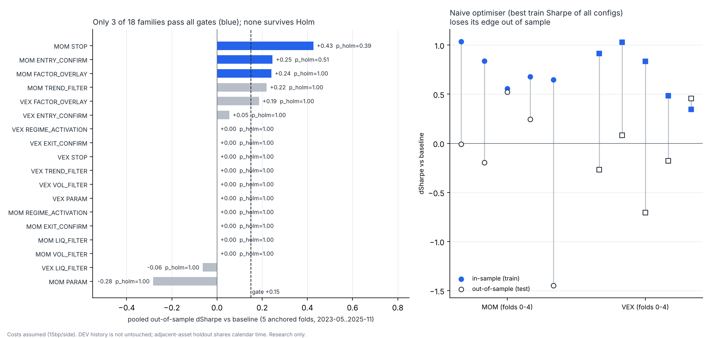

# STAGE 06 - Limited, predeclared changes to eligible strategies: validation report

Research only. No orders, credentials or execution. Baselines, `REPORT.md`, `results/`, `PREREGISTRATION.md` and the Stage 01-05 handoffs are unchanged.

## Headline

**KEEP BASELINE for both CRY-MOM-101 and CRY-VEX-103. No candidate change is supported by independent validation.**

* 71 configurations (34 MOM, 37 VEX) in 18 predeclared families were tested, each under assumed costs (15bp/side) in every trial. Three MOM families passed every walk-forward gate (ENTRY_CONFIRM confirm=3, STOP 2.5/4.0, FACTOR_OVERLAY EQ3).
* None survives multiple-testing correction (Holm over 18 families: adjusted p 0.39, 0.51, 1.00). Selection skill is not distinguishable from chance (PBO 0.47 MOM / 0.46 VEX; reality check p=0.12 / 0.83).
* On the never-run adjacent assets (BNB, DOT, ATOM, BCH; single shot) ENTRY_CONFIRM was neutral-to-negative (dSharpe -0.015) and STOP clearly worse (dSharpe -0.215, maxDD -20.6% vs -12.8%): both REJECT. FACTOR_OVERLAY and the combo cannot be tested there: UNVERIFIED_HYPOTHESIS.
* **New adverse finding about the baselines:** on the adjacent assets MOM baseline Sharpe is -0.20 (3 of 4 assets lose) and VEX baseline Sharpe -1.71 with maxDD -46.5% (loses on all 4 assets). VEX is also cost-fragile (Sharpe +1.78 at zero cost, +0.64 at 1x, -0.20 at 2x). Neither baseline generalises beyond the survivor-selected cohort on this evidence.
* Limits: there is no untouched temporal holdout (2025-11-17..2026-11-17 is CONSUMED_LEGACY; DEV history was seen in Stages 02-05). The adjacent-asset holdout shares calendar time and BTC beta and has few trades. Costs, venue and fills are assumed. Thresholds are judgement-based and uncalibrated.

## 0. Design, splits and acceptance thresholds (committed before any real-data run: `STAGE_06_ANALYSIS_PLAN.md`, commit 8da94ed)

* Eligible: MOM-101, VEX-103. REV-102 excluded (Stage 02 REJECT / Stage 03 NOT_ELIGIBLE).
* DEV 2021-11-17..2025-11-17; anchored folds, test = 6 months from 2023-05-17 (5 folds: 2023-05-17..2023-11-17; 2023-11-17..2024-05-17; 2024-05-17..2024-11-17; 2024-11-17..2025-05-17; 2025-05-17..2025-11-17). Train = [2021-11-17, test start). Every window is a fresh $10,000 book, force-closed at window end.
* Baseline reproduction (asserted before any candidate ran): MOM-101|train: n=94, ratio +0.2430, match=True; MOM-101|validation: n=49, ratio +0.1382, match=True; VEX-103|train: n=724, ratio +0.0006, match=True; VEX-103|validation: n=260, ratio +0.0717, match=True.
* Selection on TRAIN only: score = neighbour-smoothed dSharpe; constraints trades>=0.75x, maxDD within 2pp, turnover<=1.25x; switch only if score>=0.10 (ordered) / 0.20 (categorical). Gates G1-G7 on pooled OOS: dSharpe>=+0.15; worst-fold DD within 1pp; trades>=0.75x; turnover<=1.25x; modal config selected in >=3/5 folds; positive under cost stress A and B; positive on full DEV with >=2/3 positive neighbours.
* ACCEPT needs finalist + Holm-adjusted p<0.05 + consistent holdout (dSharpe>=0, trades>=0.75x, DD within 1pp). Otherwise UNVERIFIED_HYPOTHESIS or REJECT. Block bootstrap: 14-day blocks, 10,000 reps, seed 20261118.
* Configurations tested: 71 x 11 windows (898 simulations incl. cost scenarios); 90 walk-forward selection decisions; 18 families -> Holm family size 18 (19 with the combo).

## A. Baseline versus candidate (pooled walk-forward OOS, baseline costs)

| family | switched folds | modal config | OOS Sharpe cand / base | dSharpe | worst-fold maxDD cand / base | trades cand / base | turnover cand / base | raw p | Holm p |
|---|---|---|---|---|---|---|---|---|---|
| MOM-101 PARAM | 5/5 | lookback=150,thr=1.0 | +0.79 / +1.07 | -0.28 | -0.164 / -0.114 | 155 / 116 | 18.2 / 14.5 | 0.656 | 1.00 |
| MOM-101 ENTRY_CONFIRM | 5/5 | confirm=3 | +1.32 / +1.07 | +0.25 | -0.093 / -0.114 | 104 / 116 | 13.2 / 14.5 | 0.03 | 0.51 |
| MOM-101 VOL_FILTER | 0/5 | - | +1.07 / +1.07 | +0.00 | -0.114 / -0.114 | 116 / 116 | 14.5 / 14.5 | n/a | 1.00 |
| MOM-101 TREND_FILTER | 3/5 | ext=1.2 | +1.29 / +1.07 | +0.22 | -0.095 / -0.114 | 98 / 116 | 12.9 / 14.5 | 0.165 | 1.00 |
| MOM-101 LIQ_FILTER | 0/5 | - | +1.07 / +1.07 | +0.00 | -0.114 / -0.114 | 116 / 116 | 14.5 / 14.5 | n/a | 1.00 |
| MOM-101 STOP | 5/5 | stop_k=2.5,trail_k=4.0 | +1.50 / +1.07 | +0.43 | -0.118 / -0.114 | 101 / 116 | 14.5 / 14.5 | 0.022 | 0.39 |
| MOM-101 EXIT_CONFIRM | 0/5 | - | +1.07 / +1.07 | +0.00 | -0.114 / -0.114 | 116 / 116 | 14.5 / 14.5 | n/a | 1.00 |
| MOM-101 FACTOR_OVERLAY | 3/5 | factor=('EQ3', 0.0) | +1.31 / +1.07 | +0.24 | -0.095 / -0.114 | 101 / 116 | 12.9 / 14.5 | 0.128 | 1.00 |
| MOM-101 REGIME_ACTIVATION | 0/5 | - | +1.07 / +1.07 | +0.00 | -0.114 / -0.114 | 116 / 116 | 14.5 / 14.5 | n/a | 1.00 |
| VEX-103 PARAM | 0/5 | - | +0.64 / +0.64 | +0.00 | -0.196 / -0.196 | 671 / 671 | 168.9 / 168.9 | n/a | 1.00 |
| VEX-103 ENTRY_CONFIRM | 2/5 | ibs_min=0.85 | +0.69 / +0.64 | +0.05 | -0.196 / -0.196 | 606 / 671 | 152.5 / 168.9 | 0.431 | 1.00 |
| VEX-103 VOL_FILTER | 0/5 | - | +0.64 / +0.64 | +0.00 | -0.196 / -0.196 | 671 / 671 | 168.9 / 168.9 | n/a | 1.00 |
| VEX-103 TREND_FILTER | 0/5 | - | +0.64 / +0.64 | +0.00 | -0.196 / -0.196 | 671 / 671 | 168.9 / 168.9 | n/a | 1.00 |
| VEX-103 LIQ_FILTER | 5/5 | vol_k=2.0,weekend=True | +0.58 / +0.64 | -0.06 | -0.145 / -0.196 | 554 / 671 | 139.1 / 168.9 | 0.681 | 1.00 |
| VEX-103 STOP | 0/5 | - | +0.64 / +0.64 | +0.00 | -0.196 / -0.196 | 671 / 671 | 168.9 / 168.9 | n/a | 1.00 |
| VEX-103 EXIT_CONFIRM | 0/5 | - | +0.64 / +0.64 | +0.00 | -0.196 / -0.196 | 671 / 671 | 168.9 / 168.9 | n/a | 1.00 |
| VEX-103 FACTOR_OVERLAY | 2/5 | factor=('EQ3', 0.0) | +0.83 / +0.64 | +0.19 | -0.196 / -0.196 | 588 / 671 | 148.3 / 168.9 | 0.098 | 1.00 |
| VEX-103 REGIME_ACTIVATION | 0/5 | - | +0.64 / +0.64 | +0.00 | -0.196 / -0.196 | 671 / 671 | 168.9 / 168.9 | n/a | 1.00 |

Sample: MOM 116 baseline OOS trades, VEX 671, over 915 OOS days. Baseline pooled OOS Sharpe MOM +1.07 / VEX +0.64 is itself noisy (Stage 02 bootstrap lower bounds were all < 0).

## B. Walk-forward results (per fold, finalist families)

**MOM-101|ENTRY_CONFIRM** (train-only selection; in-sample dS of chosen vs OOS dS)

| fold | chosen | train-selection score | in-sample dS | OOS dS | OOS trades cand / base |
|---|---|---|---|---|---|
| 0 | {"confirm": 2} | +0.14 | +0.07 | -0.08 | 13 / 13 |
| 1 | {"confirm": 3} | +0.14 | +0.23 | +0.75 | 25 / 30 |
| 2 | {"confirm": 3} | +0.30 | +0.36 | +0.67 | 18 / 22 |
| 3 | {"confirm": 3} | +0.36 | +0.42 | +0.01 | 18 / 20 |
| 4 | {"confirm": 3} | +0.30 | +0.36 | -0.16 | 30 / 31 |

Degradation (switched folds): in-sample dS +0.29 -> OOS +0.24. Paired bootstrap dSharpe 95% CI [+0.01, +0.54].

**MOM-101|STOP** (train-only selection; in-sample dS of chosen vs OOS dS)

| fold | chosen | train-selection score | in-sample dS | OOS dS | OOS trades cand / base |
|---|---|---|---|---|---|
| 0 | {"stop_k": 2.5, "trail_k": 4.0} | +0.39 | +0.78 | +1.25 | 11 / 13 |
| 1 | {"stop_k": 2.5, "trail_k": 4.0} | +0.42 | +0.84 | -0.20 | 30 / 30 |
| 2 | {"stop_k": 2.5, "trail_k": 4.0} | +0.27 | +0.56 | +0.52 | 19 / 22 |
| 3 | {"stop_k": 3.0, "trail_k": 4.0} | +0.27 | +0.43 | -0.01 | 16 / 20 |
| 4 | {"stop_k": 3.0, "trail_k": 4.0} | +0.23 | +0.37 | +0.29 | 25 / 31 |

Degradation (switched folds): in-sample dS +0.59 -> OOS +0.37. Paired bootstrap dSharpe 95% CI [-0.04, +0.92].

**MOM-101|FACTOR_OVERLAY** (train-only selection; in-sample dS of chosen vs OOS dS)

| fold | chosen | train-selection score | in-sample dS | OOS dS | OOS trades cand / base |
|---|---|---|---|---|---|
| 0 | baseline | -0.04 | +0.00 | +0.00 | 13 / 13 |
| 1 | baseline | +0.01 | +0.00 | +0.00 | 30 / 30 |
| 2 | {"factor": ["EQ3", 0.0]} | +0.25 | +0.25 | +0.67 | 15 / 22 |
| 3 | {"factor": ["EQ3", 0.0]} | +0.33 | +0.33 | +0.62 | 14 / 20 |
| 4 | {"factor": ["EQ3", 0.0]} | +0.41 | +0.41 | +0.05 | 29 / 31 |

Degradation (switched folds): in-sample dS +0.33 -> OOS +0.44. Paired bootstrap dSharpe 95% CI [-0.05, +0.61].

**VEX-103|FACTOR_OVERLAY** (train-only selection; in-sample dS of chosen vs OOS dS)

| fold | chosen | train-selection score | in-sample dS | OOS dS | OOS trades cand / base |
|---|---|---|---|---|---|
| 0 | {"factor": ["EQ3", 0.0]} | +0.23 | +0.23 | +0.66 | 75 / 108 |
| 1 | {"factor": ["EQ3", 0.0]} | +0.39 | +0.39 | +0.42 | 102 / 152 |
| 2 | baseline | n/a | +0.00 | +0.00 | 151 / 151 |
| 3 | baseline | n/a | +0.00 | +0.00 | 124 / 124 |
| 4 | baseline | n/a | +0.00 | +0.00 | 136 / 136 |

Degradation (switched folds): in-sample dS +0.31 -> OOS +0.54. Paired bootstrap dSharpe 95% CI [-0.07, +0.46].

Fold-level OOS windows hold only 11-31 MOM trades, so single folds are noise-dominated; only pooled results are interpreted.

**Selection-bias diagnostics (per strategy, all configurations on full DEV vs baseline):**

| strategy | K configs | reality-check p (best dev config) | PBO (CSCV, S=8, 70 splits) | median OOS rank of IS-best |
|---|---|---|---|---|
| MOM-101 | 34 | 0.12 (PARAM|lookback=210,thr=1.0) | 0.47 | 0.53 |
| VEX-103 | 37 | 0.83 (FACTOR_OVERLAY|factor=('EQ3', 0.0)) | 0.46 | 0.55 |

Naive optimiser (best train Sharpe among ALL configs of the strategy, per fold): MOM in-sample dS +0.56..+1.04 vs OOS -1.45..+0.52 (mean -0.18); VEX in-sample +0.35..+1.03 vs OOS mean -0.12. This is why highest-in-sample-Sharpe was never the selection rule.

## C. Parameter stability (full-DEV dSharpe vs baseline for every point; neighbours)

| family | point | DEV n | DEV Sharpe | dS vs base |
|---|---|---|---|---|
| MOM-101 PARAM | {"lookback": 150, "thr": 1.0} | 195 | +1.05 | +0.38 |
| MOM-101 PARAM | {"lookback": 150, "thr": 1.25} | 147 | +0.60 | -0.07 |
| MOM-101 PARAM | {"lookback": 150, "thr": 1.5} | 106 | +0.90 | +0.23 |
| MOM-101 PARAM | {"lookback": 180, "thr": 1.0} | 205 | +0.71 | +0.04 |
| MOM-101 PARAM | {"lookback": 180, "thr": 1.5} | 92 | +0.71 | +0.05 |
| MOM-101 PARAM | {"lookback": 210, "thr": 1.0} | 204 | +1.11 | +0.44 |
| MOM-101 PARAM | {"lookback": 210, "thr": 1.25} | 157 | +0.69 | +0.03 |
| MOM-101 PARAM | {"lookback": 210, "thr": 1.5} | 107 | +0.67 | +0.00 |
| MOM-101 ENTRY_CONFIRM | {"confirm": 2} | 128 | +0.84 | +0.18 |
| MOM-101 ENTRY_CONFIRM | {"confirm": 3} | 123 | +0.94 | +0.28 |
| MOM-101 VOL_FILTER | {"rvr": 1.5} | 140 | +0.61 | -0.05 |
| MOM-101 VOL_FILTER | {"rvr": 1.25} | 137 | +0.59 | -0.08 |
| MOM-101 TREND_FILTER | {"ext": 1.2} | 107 | +1.13 | +0.46 |
| MOM-101 TREND_FILTER | {"ext": 1.45} | 161 | +0.81 | +0.14 |
| MOM-101 LIQ_FILTER | {"l1": 50000000.0} | 132 | +0.58 | -0.08 |
| MOM-101 LIQ_FILTER | {"l1": 100000000.0} | 126 | +0.42 | -0.25 |
| MOM-101 STOP | {"stop_k": 2.5, "trail_k": 3.0} | 179 | +0.82 | +0.15 |
| MOM-101 STOP | {"stop_k": 2.5, "trail_k": 3.5} | 151 | +0.69 | +0.02 |
| MOM-101 STOP | {"stop_k": 2.5, "trail_k": 4.0} | 125 | +1.07 | +0.40 |
| MOM-101 STOP | {"stop_k": 3.0, "trail_k": 3.0} | 172 | +0.86 | +0.20 |
| MOM-101 STOP | {"stop_k": 3.0, "trail_k": 4.0} | 120 | +1.02 | +0.36 |
| MOM-101 STOP | {"stop_k": 3.5, "trail_k": 3.0} | 169 | +0.85 | +0.18 |
| MOM-101 STOP | {"stop_k": 3.5, "trail_k": 3.5} | 137 | +0.65 | -0.02 |
| MOM-101 STOP | {"stop_k": 3.5, "trail_k": 4.0} | 113 | +1.09 | +0.42 |
| MOM-101 EXIT_CONFIRM | {"exit_n": 2} | 141 | +0.66 | -0.00 |
| MOM-101 EXIT_CONFIRM | {"exit_n": 3} | 140 | +0.69 | +0.03 |
| MOM-101 FACTOR_OVERLAY | {"factor": ["EQ3", 0.0]} | 114 | +1.03 | +0.37 |
| MOM-101 FACTOR_OVERLAY | {"factor": ["PRIOR5", 0.0]} | 123 | +0.75 | +0.09 |
| MOM-101 FACTOR_OVERLAY | {"factor": ["VOLONLY", 0.0]} | 100 | +0.67 | +0.00 |
| MOM-101 FACTOR_OVERLAY | {"factor": ["EQ3", 0.5]} | 63 | +0.49 | -0.17 |
| MOM-101 REGIME_ACTIVATION | {"regime": "DIR_NOT_BEARISH"} | 141 | +0.66 | +0.00 |
| MOM-101 REGIME_ACTIVATION | {"regime": "STRUCT_TRENDING"} | 83 | +1.10 | +0.44 |
| MOM-101 REGIME_ACTIVATION | {"regime": "VOL_NOT_HIGH"} | 139 | +0.69 | +0.02 |
| VEX-103 PARAM | {"donch": 36, "tr_k": 1.5} | 1170 | +0.03 | -0.24 |
| VEX-103 PARAM | {"donch": 36, "tr_k": 1.8} | 1046 | +0.06 | -0.21 |
| VEX-103 PARAM | {"donch": 36, "tr_k": 2.2} | 854 | +0.08 | -0.19 |
| VEX-103 PARAM | {"donch": 48, "tr_k": 1.5} | 1095 | +0.21 | -0.05 |
| VEX-103 PARAM | {"donch": 48, "tr_k": 2.2} | 807 | +0.25 | -0.02 |
| VEX-103 PARAM | {"donch": 72, "tr_k": 1.5} | 1027 | +0.15 | -0.12 |
| VEX-103 PARAM | {"donch": 72, "tr_k": 1.8} | 926 | +0.20 | -0.06 |
| VEX-103 PARAM | {"donch": 72, "tr_k": 2.2} | 768 | +0.17 | -0.10 |
| VEX-103 ENTRY_CONFIRM | {"ibs_min": 0.65} | 1133 | -0.21 | -0.47 |
| VEX-103 ENTRY_CONFIRM | {"ibs_min": 0.85} | 746 | +0.53 | +0.26 |
| VEX-103 VOL_FILTER | {"comp": 1.0} | 529 | +0.41 | +0.14 |
| VEX-103 VOL_FILTER | {"comp": 0.8} | 299 | +0.63 | +0.37 |
| VEX-103 TREND_FILTER | {"ctxp": 100} | 864 | +0.22 | -0.04 |
| VEX-103 TREND_FILTER | {"ctxp": 200} | 757 | +0.15 | -0.12 |
| VEX-103 LIQ_FILTER | {"vol_k": 1.5, "weekend": false} | 1031 | +0.18 | -0.08 |
| VEX-103 LIQ_FILTER | {"vol_k": 1.5, "weekend": true} | 812 | +0.49 | +0.22 |
| VEX-103 LIQ_FILTER | {"vol_k": 2.0, "weekend": true} | 784 | +0.54 | +0.27 |
| VEX-103 LIQ_FILTER | {"vol_k": 2.5, "weekend": false} | 918 | +0.33 | +0.06 |
| VEX-103 LIQ_FILTER | {"vol_k": 2.5, "weekend": true} | 738 | +0.53 | +0.27 |
| VEX-103 STOP | {"stop_k": 1.5, "trail_k": 2.0} | 1043 | -0.42 | -0.69 |
| VEX-103 STOP | {"stop_k": 1.5, "trail_k": 2.5} | 978 | -0.30 | -0.57 |
| VEX-103 STOP | {"stop_k": 1.5, "trail_k": 3.0} | 947 | -0.23 | -0.50 |
| VEX-103 STOP | {"stop_k": 2.0, "trail_k": 2.0} | 1064 | +0.01 | -0.26 |
| VEX-103 STOP | {"stop_k": 2.0, "trail_k": 3.0} | 951 | +0.19 | -0.08 |
| VEX-103 STOP | {"stop_k": 2.5, "trail_k": 2.0} | 1072 | -0.03 | -0.30 |
| VEX-103 STOP | {"stop_k": 2.5, "trail_k": 2.5} | 985 | +0.23 | -0.03 |
| VEX-103 STOP | {"stop_k": 2.5, "trail_k": 3.0} | 944 | +0.11 | -0.15 |
| VEX-103 EXIT_CONFIRM | {"fail_bars": 3} | 980 | +0.21 | -0.06 |
| VEX-103 EXIT_CONFIRM | {"fail_bars": 12} | 987 | +0.30 | +0.04 |
| VEX-103 FACTOR_OVERLAY | {"factor": ["EQ3", 0.0]} | 676 | +0.61 | +0.34 |
| VEX-103 FACTOR_OVERLAY | {"factor": ["PRIOR5", 0.0]} | 609 | +0.45 | +0.18 |
| VEX-103 FACTOR_OVERLAY | {"factor": ["VOLONLY", 0.0]} | 636 | -0.19 | -0.46 |
| VEX-103 FACTOR_OVERLAY | {"factor": ["EQ3", 0.5]} | 289 | +0.05 | -0.22 |
| VEX-103 REGIME_ACTIVATION | {"regime": "DIR_NOT_BEARISH"} | 795 | +0.36 | +0.09 |
| VEX-103 REGIME_ACTIVATION | {"regime": "STRUCT_TRENDING"} | 498 | +0.11 | -0.15 |
| VEX-103 REGIME_ACTIVATION | {"regime": "VOL_NOT_HIGH"} | 903 | +0.34 | +0.07 |

Modal-config neighbour check (G7): MOM-101|ENTRY_CONFIRM modal dS +0.28, neighbours [0.18]; MOM-101|STOP modal dS +0.40, neighbours [0.02, 0.0, 0.36]; MOM-101|FACTOR_OVERLAY modal dS +0.37, neighbours []. STOP passes G7 only marginally (one neighbour exactly 0.00 of three). Categorical families (FACTOR_OVERLAY, REGIME_ACTIVATION) have no grid neighbours, so G7's neighbour part is vacuous for them; the higher 0.20 selection margin is the only compensation.

## D. Cost sensitivity (pooled OOS test folds; per-side fee+adverse multiples; modal config held fixed across folds, so slightly optimistic)

| config | 0x | 0.5x | 1x | 2x | 3x | stress A | stress B |
|---|---|---|---|---|---|---|---|
| MOM-101 BASELINE | +1.24 | +1.16 | +1.07 | +0.91 | +0.75 | +0.91 | +0.91 |
| VEX-103 BASELINE | +1.78 | +1.21 | +0.64 | -0.20 | -0.60 | -0.20 | -0.37 |
| MOM-101 PARAM lookback=150,thr=1.0 | +1.36 | +1.27 | +1.17 | +0.98 | +0.80 | +0.98 | +0.98 |
| MOM-101 ENTRY_CONFIRM confirm=3 | +1.47 | +1.39 | +1.32 | +1.16 | +1.01 | +1.16 | +1.16 |
| MOM-101 TREND_FILTER ext=1.2 | +1.65 | +1.58 | +1.50 | +1.36 | +1.21 | +1.36 | +1.36 |
| MOM-101 STOP stop_k=2.5,trail_k=4.0 | +1.52 | +1.45 | +1.38 | +1.24 | +1.09 | +1.24 | +1.24 |
| MOM-101 FACTOR_OVERLAY factor=('EQ3', 0.0) | +1.78 | +1.71 | +1.64 | +1.50 | +1.36 | +1.50 | +1.50 |
| VEX-103 ENTRY_CONFIRM ibs_min=0.85 | +1.82 | +1.36 | +0.97 | -0.12 | -0.83 | -0.12 | +0.10 |
| VEX-103 LIQ_FILTER vol_k=2.0,weekend=True | +1.67 | +1.14 | +0.65 | -0.18 | -0.51 | -0.18 | -0.38 |
| VEX-103 FACTOR_OVERLAY factor=('EQ3', 0.0) | +1.95 | +1.51 | +1.10 | +0.09 | -0.07 | +0.09 | +0.16 |

MOM variants stay positive to 3x cost. VEX baseline and the VEX variants turn non-positive or ~0 at 2x-3x: VEX's edge is a thin gross edge consumed by turnover, and costs are assumed, not observed.

## E. Holdout evaluation (adjacent assets BNB, DOT, ATOM, BCH; single shot; DEV window 2021-11-17..2025-11-17)

Data audit: 48,641 hourly rows per asset, 7 missing bars (3 gap events), no OHLC violations. Holdout is cross-sectional only (same calendar time and BTC beta), 4 assets.

| config | trades | Sharpe | ratio | maxDD | dSharpe vs baseline | stress A / B dSharpe | holdout verdict |
|---|---|---|---|---|---|---|---|
| MOM-101 BASELINE | 71 | -0.20 | -0.089 | -0.128 | - | - | baseline |
| VEX-103 BASELINE | 325 | -1.71 | -0.240 | -0.465 | - | - | baseline |
| MOM-101 ENTRY_CONFIRM confirm=3 | 60 | -0.21 | -0.096 | -0.117 | -0.015 | -0.01 / -0.01 | INCONSISTENT |
| MOM-101 STOP stop_k=2.5,trail_k=4.0 | 74 | -0.41 | -0.210 | -0.206 | -0.215 | -0.21 / -0.21 | INCONSISTENT |
| MOM-101 FACTOR_OVERLAY factor=('EQ3', 0.0) | - | - | - | - | - | - | NOT_TESTABLE (factor cross-section) |
| MOM-101 COMBO | - | - | - | - | - | - | NOT_TESTABLE (factor cross-section) |

Post-hoc per-asset diagnostic (descriptive; changes no determination): MOM baseline ratio BNB +0.14 (35 trades), DOT -0.24, ATOM -0.21, BCH -0.62; VEX loses on all four (-0.12 to -0.41). Buy-and-hold log return over DEV: BNB +0.46, BCH -0.21, ATOM -2.32, DOT -2.68. Consumed-window numbers (CONSUMED_LEGACY, descriptive only) are in the JSON files and were never a criterion: MOM baseline Sharpe -0.47, its three finalists -0.32 / -0.20 / -0.34, VEX baseline +0.47, VEX factor overlay -1.51.

## F. Determination

| candidate family | determination | reason |
|---|---|---|
| MOM-101 PARAM | **REJECT** | fails: dSharpe<+0.15; worst-fold DD worse >1pp; turnover>1.25x; unstable/never selected (<3/5 folds); neighbours/full-DEV not positive |
| MOM-101 ENTRY_CONFIRM | **REJECT** | passed G1-G7 but adjacent-asset holdout inconsistent (dSharpe -0.015, maxDD -0.117 vs -0.128) |
| MOM-101 VOL_FILTER | **REJECT** | baseline retained in all 5 folds (no train-supported improvement) |
| MOM-101 TREND_FILTER | **REJECT** | fails: neighbours/full-DEV not positive |
| MOM-101 LIQ_FILTER | **REJECT** | baseline retained in all 5 folds (no train-supported improvement) |
| MOM-101 STOP | **REJECT** | passed G1-G7 but adjacent-asset holdout inconsistent (dSharpe -0.215, maxDD -0.206 vs -0.128) |
| MOM-101 EXIT_CONFIRM | **REJECT** | baseline retained in all 5 folds (no train-supported improvement) |
| MOM-101 FACTOR_OVERLAY | **UNVERIFIED_HYPOTHESIS** | passed G1-G7; Holm p=1.00; not testable on holdout (needs cross-section >=5 assets) |
| MOM-101 REGIME_ACTIVATION | **REJECT** | baseline retained in all 5 folds (no train-supported improvement) |
| VEX-103 PARAM | **REJECT** | baseline retained in all 5 folds (no train-supported improvement) |
| VEX-103 ENTRY_CONFIRM | **REJECT** | fails: dSharpe<+0.15; unstable/never selected (<3/5 folds); neighbours/full-DEV not positive |
| VEX-103 VOL_FILTER | **REJECT** | baseline retained in all 5 folds (no train-supported improvement) |
| VEX-103 TREND_FILTER | **REJECT** | baseline retained in all 5 folds (no train-supported improvement) |
| VEX-103 LIQ_FILTER | **REJECT** | fails: dSharpe<+0.15; not cost-robust |
| VEX-103 STOP | **REJECT** | baseline retained in all 5 folds (no train-supported improvement) |
| VEX-103 EXIT_CONFIRM | **REJECT** | baseline retained in all 5 folds (no train-supported improvement) |
| VEX-103 FACTOR_OVERLAY | **REJECT** | fails: unstable/never selected (<3/5 folds) |
| VEX-103 REGIME_ACTIVATION | **REJECT** | baseline retained in all 5 folds (no train-supported improvement) |
| MOM combo (confirm=3 + stop 2.5/4.0 + factor EQ3) | **UNVERIFIED_HYPOTHESIS** | built after seeing which families passed; raw p=0.0044, Holm over 19 hypotheses ~0.084; modal config fixed across folds uses later folds' selections (optimistic); untestable on holdout |

**CRY-MOM-101: KEEP BASELINE.** **CRY-VEX-103: KEEP BASELINE** (no candidate improved it; the baseline itself fails the adjacent-asset holdout and is cost-fragile, supporting Stage 03's shadow-only stance). Counts: 0 ACCEPT_CANDIDATE, 2 UNVERIFIED_HYPOTHESIS (FACTOR_OVERLAY on MOM; combo), 17 REJECT (15 families that failed gates and 2 finalists that failed the holdout: ENTRY_CONFIRM, STOP) - 18 families + 1 combo = 19 determinations.

Retained as unverified hypotheses only: MOM entry persistence (K=3) and wider trailing stop (4.0 ATR with 2.5 ATR initial) are not supported but not refuted in direction; the first was neutral on the holdout. The Stage 05 factor overlay has low prior (Stage 05 found no demonstrated factor skill; VEX overlay was -1.51 Sharpe in the consumed window).

## Limitations and unresolved concerns

* No untouched temporal holdout; walk-forward folds 4-5 overlap the Stage 02 validation window and the whole DEV history informed Stage 01-05 design.
* Adjacent-asset holdout shares calendar time/BTC beta; 4 assets; MOM 71 trades, so a real improvement of ~0.2 Sharpe would not be detectable (dSharpe CI width ~0.9).
* Costs (15bp/side), fills, lot sizes and venue are assumed; stop-through slippage is not modelled beyond open-gap fills.
* Gate thresholds (+0.15, 0.75x, 1.25x, 1pp, 0.10/0.20 margins) are judgement-based, not calibrated.
* Factor overlay uses Stage 05 scores that exist only from 2022-05-01 (baseline rule applies before); not holdout-testable.
* Regime tags are the uncalibrated Stage 04 rules; REGIME_ACTIVATION never beat the baseline in train and was never selected.
* Stop changes alter risk-based position size (fixed 1% risk / tighter stop = larger notional); Sharpe comparisons embed that.
* Survivor-selected cohort; the adjacent-asset result is direct evidence against generalisation of both baselines.
* `research/validation/adjudicate.py` not run; preregistration not frozen (needs independent review). Ledger: 18 hypotheses registered.

## Files

`stage06/` (code), `tests/stage06/` (14 offline tests), `docs/strategy-specs/stage06/`: `stage06_dev_results.json`, `frozen_candidates.json` (sha256 85cc5f873d24dd188fccd6a978467f5c33a41c50f3dc0e2aea21c72f5478a7b1), `stage06_holdout_results.json`, `stage06_cost_sensitivity.json`, `trials.csv` (every configuration x window), `diag_holdout_posthoc.txt`, `stage06_walkforward.png`. Reproduce: `PYTHONPATH=. scripts/lab python -m stage06.run_dev` (~45 s, deterministic).
